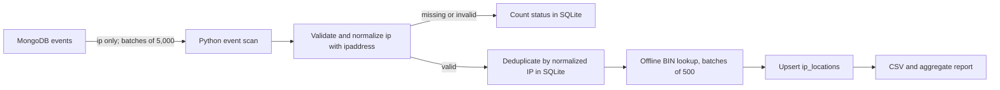

# Glamira Project 5: sample data quality

This project extracts a bounded local sample from a Glamira MongoDB BSON dump and assesses its data quality. The current sample is a **sequential, non-random prefix**: findings describe the sample, not the 41 million-document collection. The quality workflow reads local JSON and does not connect to MongoDB or GCP.

## Setup

Install Python and `uv`, put `glamira_ubl_oct2019_nov2019.tar.gz` in the project root, then run:

```bash
uv sync
uv run extract-sample --limit 100000
uv run assess-data-quality
```

If the JSON sample already exists, skip extraction and run the quality command directly. Samples under `data/` are ignored by Git and can contain customer data.

## Extract a sample

The extractor reads `dump/countly/summary.bson` from the compressed tar stream, one document at a time, and stops at the requested limit (1–100,000). It creates:

- `data/summary_sample.json`: a Canonical Extended JSON array, preserving BSON types.
- `data/summary_sample.metadata.json`: source, selection method, counts, size, and extraction time.

Use `uv run extract-sample --help` for `--archive`, `--limit`, and `--output`. The output path must end in `.json`; metadata uses the same stem. Rerunning replaces those two outputs after successful extraction. A malformed or missing source returns a nonzero exit and staged files are cleaned up. Existing BSON sample files are left untouched.

## Assess data quality

```bash
uv run assess-data-quality --sample data/summary_sample.json --max-documents 100000
```

The command streams up to 100,000 JSON documents in one pass. Duplicate detection keeps hashes of identifiers and IP/timestamp pairs without retaining raw IP addresses or full records. If the input exceeds the cap, the report says only a prefix was assessed. Use `--output-dir` to choose the directory for the reports.

The command creates [a short summary](docs/reports/data_quality_report.md) and six reports under `docs/reports/data_quality/`:

- `nulls.md`: top-level missing and explicit-null rates, with >50% flagged for review.
- `duplicates.md`: `_id` and IP/timestamp duplicate counts, group sizes, mixed event types, and IPv4/IPv6/invalid-address breakdowns.
- `timestamps.md`: UTC timestamp range and future values, plus local time field coverage and wall-clock range (timezone unknown).
- `revenue.md`: leading negative signs in `checkout_success` item prices.
- `currencies.md`: top-level and cart-item currency values.
- `ip_addresses.md`: completeness and IPv4/IPv6 syntax counts.

The checks treat missing keys, BSON nulls, and empty values separately. Sparse event-specific fields are not automatically defects; IP/timestamp duplicates do not prove duplicate events. Numeric `time_stamp` values are interpreted as Unix seconds in UTC, an assumption to confirm with the data producer. Checkout prices occur inside `cart_products`; order-level revenue and unusually large prices remain unassessed until price semantics, locale parsing, and thresholds are confirmed. Currency symbols may be ambiguous.

Input errors return a nonzero exit before reports are generated. The report writer stages all seven files before publishing each one; the summary is published last. The generated reports can be replaced by rerunning the command.

## Historical event-field specification

The earlier [event-field specification](docs/specifications/event_type_expected_fields.preview.md) is retained as a historical observation of the same local sample. Its former profiler and supporting metrics have been removed.

## Tests

```bash
uv run python -m unittest discover -s tests/unit -v
```

## Local IP geolocation sample

This workflow seeds the first 1,000 events from the existing sequential JSON sample into an isolated **local** MongoDB database, then resolves unique IPs using the IP2Location BIN file offline. It does not process the full dataset. Install the project with `uv sync` and start a local MongoDB instance first. The commands accept only loopback MongoDB hosts; set `MONGODB_URI` in the environment if a local port or authentication differs from `127.0.0.1:27017`. Do not use an SSH tunnel for this local sample: a loopback address can also forward to a remote server.

For example, to start an isolated local MongoDB with Docker and a persistent sample volume:

```bash
docker run -d --name glamira-ip-sample-local -p 127.0.0.1:27019:27017 \
  --mount type=volume,source=glamira_ip_sample_data,target=/data/db mongo:8.0
export MONGODB_URI=mongodb://127.0.0.1:27019/
```

Choose an unused local port. If the container already exists, use `docker port glamira-ip-sample-local 27017/tcp` to find its port. Stop the container with `docker stop glamira-ip-sample-local`; the named volume retains its sample data.

```bash
uv run seed-ip-sample --limit 1000
uv run enrich-ip-locations --bin IP-COUNTRY-REGION-CITY.BIN
```

The dedicated database defaults to `glamira_ip_sample`, with source collection `events`, result collection `ip_locations`, and BIN provenance collection `enrichment_runs`. A sample can contain at most 10,000 events. Enrichment reads only the `ip` field; records with missing, null, empty, invalid and non-public values remain visible in the metrics. IPs are normalized and deduplicated before lookup. Each `ip_locations` document uses normalized IP as `_id` and stores `ip_version`, `status`, `country_code`, `country_name`, `region`, `city`, and `database_id`. The BIN SHA-256 is the stable `database_id`; the matching `enrichment_runs` document stores the BIN filename, date, edition, checksum, and processing timestamp. Event frequency is kept in local checkpoint/coverage metrics, not duplicated into the location collection. MongoDB's default `_id` index provides uniqueness; no separate IP index is created.

Outputs are in ignored `data/ip_location_sample/`: `ip_locations.csv` follows the `ip_locations` schema and contains private IP information, `checkpoint.sqlite3` stores progress and event counts used for coverage, and `ip_location_report.md` plus `ip_location_metrics.json` contain aggregate statistics. Custom output and checkpoint paths must also be under `data/`. Event coverage divides successfully geolocated events by all sampled events; unique-IP coverage divides resolved IPs by valid unique IPs. The 80% goal is reported as a target, not assumed achieved. A sequential prefix is not representative of the full collection.

Run the same command to resume. Event batches and their progress are committed together; MongoDB upserts are safe to repeat after interruption. The checkpoint is tied to the sample collection identity, source file, connection and BIN checksum. Use a fresh local database and checkpoint for a different sample or BIN; `--retry-failed` retries failed lookups. Keep the seeded source collection unchanged and run only one enrichment process per checkpoint at a time.

The sample command uses seeded integer IDs and rejects non-sample database names. Full-dataset processing uses the separate command below, which checkpoints the source's BSON `_id` values and targets dedicated output collections.

### Full collection enrichment (VM execution)

`uv run enrich-ip-locations-full` is a separate full-data command. It streams `countly.summary` in ascending `_id` order with bounded MongoDB batches, stores deduplicated IP counts and the BSON resume cursor in a private SQLite checkpoint, then looks up unique addresses with the memory-mapped BIN. The target is `countly.ip_locations`; BIN provenance is upserted into `countly.enrichment_runs`. The output CSV follows the same location schema. The command does not drop collections or create an extra IP index.

The scan asks MongoDB only for `ip`, then validates addresses in Python. Missing, null or invalid values are counted; no fallback field is used.



Run it on the VM itself so MongoDB is reached through loopback. Supply `MONGODB_URI` from a protected environment/config file, never as a command-line argument. Choose checkpoint/output paths on a mounted filesystem with enough room for the SQLite unique-IP index and CSV, and preserve them across retries:

```bash
uv run enrich-ip-locations-full \
  --bin /path/to/IP-COUNTRY-REGION-CITY.BIN \
  --checkpoint /path/to/private/ip-location-checkpoint.sqlite3 \
  --output-dir /path/to/private/ip-location-output
```

The checkpoint is bound to source and destination collection UUIDs and the BIN checksum. It assumes the source collection remains unchanged during the scan; prevent concurrent source writes while enriching. Restarting with the same checkpoint resumes the `_id` scan and replays safe upserts. This command is intended for VM execution and must first be validated against the actual source and free disk space. The currently running VM has not completed a full enrichment run.

The supplied BIN header identifies DB3 dated 2016-11-29: it provides country, region and city for IPv4, but no latitude, longitude or IPv6 ranges. It predates the 2019 events, so the lookup is an estimate rather than verified historical location. Unsupported IPv6, non-public addresses, no-match and failed lookups are counted separately. Confirm the database's license before any redistribution.
