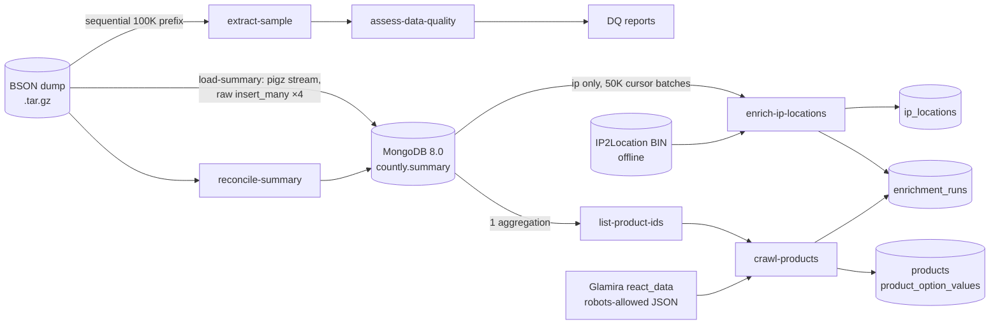

# Glamira event pipeline

Batch data engineering on **41.4 million e-commerce tracking events** from Glamira, an online jewellery retailer, collected in October–November 2019. The events lack two dimensions that analysis needs: *where* a visitor was and *what* product they looked at. This repository:

- profiles the data;
- loads and validates it in MongoDB;
- enriches it with IP geolocation and product attributes;
- records how every decision was made and verified.

It answers to three business questions: geographic performance, product and category performance, and time trends. Loading into GCS → BigQuery → dbt → dashboards is the next stage and is **not** part of this repository.

## Results at a glance

| Stage | Result |
| --- | --- |
| Source | `countly.summary`: 41,432,473 events restored from a BSON dump (33.5 GB uncompressed) |
| Full load | `load-summary` loads all 41,432,473 events in 8 min 41 s and resumes after a crash. Measured in a separate benchmark database; the existing `countly.summary` was restored earlier with `mongorestore` (14 min 51 s, 0 failures). `reconcile-summary` confirms totals, all 27 event-type counts, and 1,000 / 1,000 byte-identical sampled documents |
| Data quality (100K sample) | 7 checks: top-level null rates, duplicate IDs and IP/time pairs, timestamps, price signs, currencies, IP syntax |
| IP geolocation | 3,239,627 unique IPs resolved offline. Coverage: 98.88% of events, 98.82% of unique IPs (target ≥ 80%) |
| Product IDs | 19,557 distinct IDs, from `product_id`, `viewing_product_id` and `cart_products[].product_id` |
| Product attributes | 19,121 found, 436 confirmed gone on all 11 English storefronts. Products without attributes cover 1.54% of event product references |
| Product options | 923,294 option-value reference rows for decoding event option IDs |

Measurements are from 2026-11-01 to 2026-11-14 on the project VM. The reports linked below hold the full numbers.

## Architecture



- **Hosting:** MongoDB runs on a Compute Engine VM with its data on a dedicated XFS persistent disk.
- **Network access:** it binds to loopback only. All access is through an SSH tunnel, and port 27017 is never exposed.
- **Where code runs:** the enrichment code runs on a workstation or the VM. It talks to MongoDB through a URI in `MONGODB_URI`, and no infrastructure details are hard-coded.

## Pipeline workflow

| # | Stage | Command | Data | Output |
| --- | --- | --- | --- | --- |
| 0.1 | Extract a bounded sample from the dump | `uv run extract-sample --limit 100000` | Sequential, non-random prefix | `data/summary_sample.json` + metadata |
| 0.2–0.3 | Profile and check quality | `uv run assess-data-quality` | Sample | [Data quality report](docs/reports/data_quality_report.md) |
| 0.4 | Decide scope | — | Evidence | [Scope confirmation](docs/reports/scope_confirmation.md): enrich IPs and products, full data |
| 1 | Load the source | `uv run load-summary --archive … --database countly --collection summary` | Full, streamed | `countly.summary`, run record in `load_runs`; [guide](src/glamira_pipeline/load/README.md) |
| 1b | Verify the load | `uv run reconcile-summary --archive … --database countly --collection summary` | Full scan + 1,000-doc sample | `summary_reconcile` record; [benchmark report](docs/reports/full_load_benchmark.md) |
| 2 | IP geolocation | `uv run enrich-ip-locations …` | Full, one scan | `ip_locations`; [guide](src/glamira_pipeline/ip_location/README.md) |
| 3a | Distinct product IDs | `uv run list-product-ids …` | Full, one scan | `product_ids.jsonl`; [report](docs/reports/product_ids_distinct.md) |
| 3b | Product collections | `uv run setup-product-collections` | — | Validated empty collections |
| 3c | Product crawl | `uv run crawl-products …` | 19,557 IDs | `products`, `product_option_values`; [guide](src/glamira_pipeline/products/README.md) |
| 4 | Schema per event type | `uv run profile-schema --size 100000` | Random `$sample` (no seed), read only | `docs/reports/schema_profile.md` (counts and type names, no values) |

Every stage is safe to rerun. Reruns either replace outputs atomically or skip work that is already finished.

## How decisions were made

Each step started with measurement on a sample, chose the simplest option that the evidence supported, and was then validated on full data.

| Question | Options weighed | Evidence | Decision |
| --- | --- | --- | --- |
| How to load 41M events | Upsert per document; gzip chunks + staging + `$merge`; `mongorestore`; raw `insert_many` | Measured each part on the full file: upsert 57 min, re-gzip +12 min, `mongorestore` 12 min, raw `insert_many` ×4 under 9 min. Duplicate-key errors already make a replay safe | **Raw `insert_many`** with a batch watermark and a reconciliation step; [report](docs/reports/full_load_benchmark.md) |
| Sample or full data? | 100K sample only; full 41M | IPs were 100% syntactically valid in the sample, and the events have product IDs but no product names | Enrich the **full** dataset; use the sample to build and test |
| IP deduplication strategy | SQLite checkpoint; in-memory `Counter` | Scan took 33m36s with SQLite vs 7m00s with Counter (649 MiB RSS). Per-IP frequencies were identical | **Counter**: restarting a 7-minute scan is cheaper than checkpointing every batch |
| Cursor batch size | 50K, 100K, 200K (both run orders) | Gains under 5% at the cost of more memory | **50K** |
| Product data source | HTML pages, Selenium, archives, `react_data` JSON | Selenium was disconnected after 2–4 pages. `react_data` is robots-allowed and returned JSON to a plain client | **`react_data`**, standard-library client, honest User-Agent |
| Which storefront | 11 English stores | Every product found was on `.com`. A full 11-store recheck of the 436 misses found none | `.com` first, **fall back on 404**, 3 stores by default |
| Crawl rate | 0.74 → 7.88 req/s ramp | Challenged at 7.4 req/s after earlier test load. No block at 3.8 req/s for 80 min | **About 4 req/s** with jitter; hard cap of 8 req/s |
| Crawl checkpoint | Sorted-ID cursor, SQLite, the data itself | Concurrent workers finish out of order; a second store would drift from the data | **The written documents are the checkpoint**: crawl `input − finished` |
| Storage target | Files during the crawl; MongoDB | MongoDB already hosts the source and provides upsert plus schema validation | **MongoDB now**; GCS/BigQuery export as a separate snapshot step |

Details and caveats:
- [Product crawl decision record](docs/decisions/product_crawl.md)
- [IP enrichment guide](src/glamira_pipeline/ip_location/README.md#why-counter-replaces-sqlite)

## How data correctness is ensured

- **Measure before assuming.** Missing keys, explicit BSON nulls, empty values and wrong types are counted separately. A missing `order_id` on a product view is expected, not a defect.
- **Never modify the source.** `countly.summary` is read only. Enrichment writes only to new collections, and nothing is dropped or overwritten without a new target.
- **Schema validation at write time.** The product collections carry strict `$jsonSchema` validators. The crawler refuses to start if they are missing or out of date.
- **One explicit row per input.**
  - Every product ID gets exactly one document, whether `success`, `not_found`, `error` or `blocked`, always with the same key set.
  - IP lookups keep explicit statuses (`resolved`, `not_public`, `no_match`, `unsupported_ipv6`, `lookup_failed`) with null locations rather than dropping rows.
- **Exact types.**
  - Prices are `Decimal128`, never floats.
  - IDs are normalized to strings so they join with events.
  - Source quirks such as `gender: false` are kept as served.
- **Reconciliation, not exit codes.**
  - Counts are checked after every full run: 19,557 product documents = 19,557 input IDs; option rows reconcile with `option_count`; IP frequencies reconcile with the 41,432,473 scanned events.
  - IP output is verified in a staging collection before publication.
- **Provenance.** Each run is recorded in `enrichment_runs`:
  - its parameters;
  - an input SHA-256 (or the BIN SHA-256);
  - the git SHA;
  - its metrics;
  - its stop reason.

## How retries stay safe

- **Idempotent writes.** All writes are upserts on deterministic `_id`s. The product crawler *sets* a computed `attempts` value instead of `$inc`, so replaying a half-written batch leaves identical documents.
- **The data is the checkpoint.** A restarted crawl loads finished IDs from MongoDB and crawls the set difference. Nothing has to be cleaned up before a rerun.
- **Bounded loss.** Batches flush by size, by time and in `finally`. A hard kill loses at most one unflushed batch, which is simply recrawled.
- **Failure accounting.** Errors are retried up to `--max-attempts`. Blocks do not count against a product.
- **Graceful stop.** SIGINT/SIGTERM finishes in-flight requests and flushes before exiting with a distinct exit code.
- **One writer at a time.** A heartbeat lock refuses a second crawl, and stale runs are marked `abandoned`.
- **Respectful backoff.** On a block the crawler stops immediately. It may resume after 5, 10 and 20 minutes, and never bypasses a challenge.
- **IP enrichment** publishes only after verification. A failed run leaves staging and artifacts for inspection, and a fresh run uses a new target.

## Setup

**Prerequisites**
- Python 3.10+ and [uv](https://docs.astral.sh/uv/).
- For the MongoDB stages, `MONGODB_URI` pointing at a **loopback** server: `127.0.0.1:27017` on the VM, or an SSH tunnel port from a workstation. Copy [`.env.example`](.env.example) to `.env`; every command refuses a missing or non-loopback URI.
- For IP enrichment, an IP2Location BIN file. Neither the BIN nor `.env` is committed.

```bash
uv sync
uv run python -m unittest discover -s tests/unit      # unit tests, no network or database
uv run extract-sample --limit 100000                  # needs the source .tar.gz in the project root
uv run assess-data-quality
```

`tests/integration/` holds tests that need a real local MongoDB and are not part of the unit suite.

## Running on the VM (full data)

Every MongoDB command runs unchanged on the VM against the full `countly.summary`; only `MONGODB_URI` differs (port 27017 instead of the tunnel port).

```bash
# Once: code and environment (no data or secrets in the repository)
git clone <repo-url> glamira-pipeline && cd glamira-pipeline
uv sync --frozen
cp .env.example .env && chmod 600 .env      # then edit the user and password
set -a && . ./.env && set +a

# Long stages: run inside tmux so an SSH disconnect does not end them
tmux new -s glamira

uv run load-summary --archive /path/to/glamira_ubl_oct2019_nov2019.tar.gz \
  --database countly --collection summary                       # ~9 min; rerun to resume
uv run reconcile-summary --archive /path/to/glamira_ubl_oct2019_nov2019.tar.gz \
  --database countly --collection summary                       # ~12 min, read only

uv run enrich-ip-locations --target ip_locations_$(date +%Y%m%d) \
  --bin /path/to/IP-COUNTRY-REGION-CITY.BIN \
  --output-dir /data/glamira/ip_location/$(date +%Y%m%d)        # ~15 min; target must be new
uv run list-product-ids --output-dir data/product_ids/full     # ~6 min, read only
uv run setup-product-collections
uv run crawl-products --ids-file data/product_ids/full/product_ids.jsonl \
  --delay 0.2 --jitter 0.1 --concurrency 6 --block-retries 3   # ~80 min; rerun to resume
```

| Concern | How it is handled |
| --- | --- |
| Defaults | `--database countly` and `--source summary` are the defaults; sample runs name their database explicitly |
| Resources | The IP scan holds unique IPs in memory (about 750 MiB measured); the other stages stream with bounded memory. Write artifacts to the data disk, not the boot disk |
| Disconnects | Run inside `tmux`. The crawl also treats `SIGHUP` like Ctrl+C: it finishes in-flight requests, flushes and records the run as `stopped` |
| Failures | Every command exits nonzero with the failed check in the message. IP enrichment keeps staging and artifacts; the crawl resumes by rerunning the same command |
| Logs | Commands log stage progress to stderr; redirect with `2>&1 | tee run.log` to keep a copy. Logs never contain the URI or raw IPs |
| Crawl egress | Requests leave from the VM's IP. Akamai may treat a cloud IP differently from the workstation IP that was measured, so start with `--limit 200` and keep the backoff enabled |
| Cost | Stop the VM when no stage runs; persistent disks are still billed |

## Repository layout

```text
src/glamira_pipeline/
├── load/           # streamed, resumable full load and reconciliation
├── sampling/       # sequential BSON sample extraction, MongoDB $sample
├── profiling/      # field presence, nulls and BSON types per event type
├── quality/        # data-quality checks and report rendering
├── ip_location/    # Counter scan, offline lookup, verified publication
├── products/       # distinct IDs, react_data crawl, MongoDB store
└── provenance.py   # file and collection identities for run records
docs/
├── reports/        # measured results (data quality, scope, product IDs, full load)
└── decisions/      # decision records
tests/unit/         # synthetic fixtures; no live services
tests/integration/  # need a disposable local MongoDB
```

## Security and cost

- **Network:** MongoDB is reachable only through the tunnel.
- **Never committed:**
  - credentials and `.env`;
  - raw dumps, samples and generated data (`data/` is ignored);
  - IP lists (raw IPs are treated as personal data).
- **VM cost:** the VM is stopped whenever no stage is running; persistent disks still incur storage cost.

## Limitations and next steps

- **Old geolocation data:** the BIN is dated 2016 and lacks IPv6, so locations are estimates. Confirm licensing before redistribution.
- **Catalog dates:** the product catalog and prices are from 2026, not 2019. Revenue must come from event prices, whose currency and locale semantics are still unconfirmed.
- **Next:**
  - Export snapshots to GCS and load them into BigQuery, deciding the `gender` representation there.
  - Write a data dictionary of all collections.
  - Use least-privilege MongoDB users for profiling and crawling.
