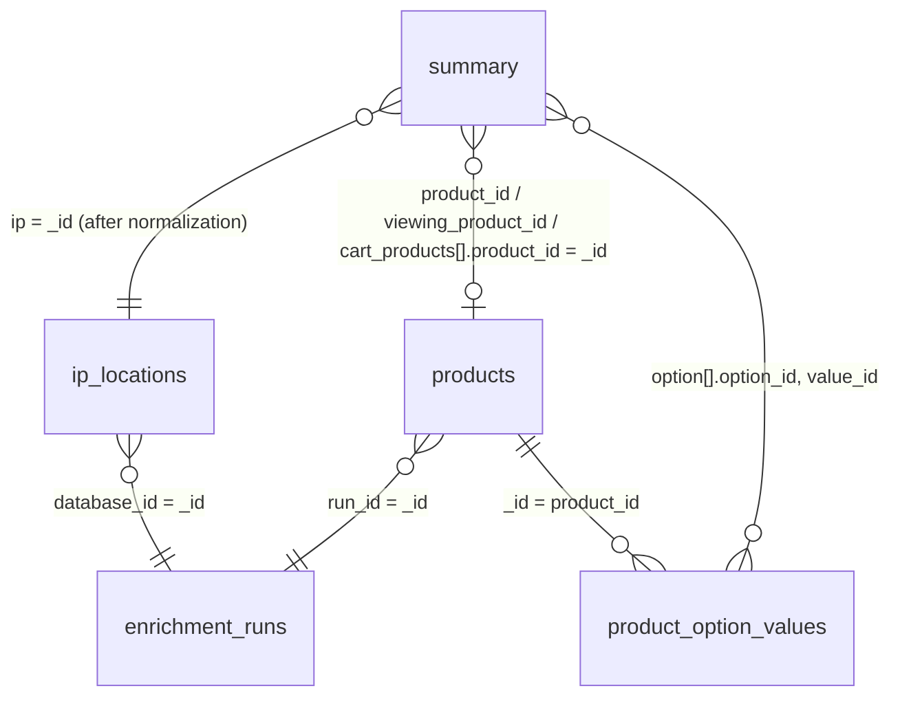

# Data Dictionary - Glamira events and enrichment

This dictionary covers every MongoDB collection the project reads or creates in the `countly` database: the raw events (`summary`) and the enrichment outputs (`ip_locations`, `products`, `product_option_values`, `enrichment_runs`).

**Evidence.**
- Event fields, types and nullability come from a **full scan** of `countly.summary`: all 41,432,473 documents, observed 2026-11-14, commit `a8e95c1`. Per-event-type tables are in the [schema profile](reports/schema_profile.md).
- Enrichment schemas come from the validators and writers in the code, plus the run verification recorded in the [IP location guide](../src/glamira_pipeline/ip_location/README.md) and the [product crawl guide](../src/glamira_pipeline/products/README.md).
- How each collection is typed in Avro and BigQuery (hashing, type unification, REQUIRED columns) is in the [raw layer contract](raw_layer_contract.md); this page describes the MongoDB source.
- Meanings are inferred from field names, values and website behaviour. The event producer's own documentation was not available. Inferred meanings are marked *(inferred)*.

**Conventions.**
- **Types** are BSON types: `string`, `int` (32-bit), `long`, `double`, `decimal` (Decimal128), `bool`, `date`, `objectId`, `object`, `array`.
- **Nullability is split into three states**, because they mean different things downstream:
  - *Missing*: the key is absent.
  - *Null*: an explicit BSON null.
  - *Empty*: `""`, a whitespace-only string, `[]` or `{}`.
- **Required** means the key was present in 100% of the events of the listed types in the full scan. It is an observation about this dataset, not a constraint enforced by MongoDB: `summary` has no validator.
- **Sensitive** fields (IP, email, user and device identifiers, user agent) are personal data. Examples are redacted.

## Collections at a glance

| Collection | Grain | Documents | Created by | Key |
|---|---|---:|---|---|
| `summary` | One tracking event | 41,432,473 | `mongorestore` of the source BSON dump | `_id` (ObjectId) |
| `ip_locations` | One unique valid IP address | 3,239,627 | `enrich-ip-locations` | `_id` = normalized IP |
| `products` | One distinct product ID seen in events | 19,557 | `crawl-products` | `_id` = product ID string |
| `product_option_values` | One option value of one product | 923,294 | `crawl-products` | `_id` = `{product_id, option_id, value_id}` |

## `summary` - raw events

27 event types share 15 common fields. Every other field belongs to a fixed set of event types, and inside those types it is always present. So a "missing" field outside its event types is expected, not a defect.

### Event types (`collection`)

| Event type | Events | Share | Event-specific fields |
|---|---:|---:|---|
| `view_listing_page` | 11,259,694 | 27.18% | `cat_id`, `collect_id`, `option` (object) |
| `view_product_detail` | 10,944,427 | 26.42% | `product_id`, `option` (array), `recommendation`, `utm_source`, `utm_medium` |
| `select_product_option` | 8,844,342 | 21.35% | `product_id`, `option` (array) |
| `select_product_option_quality` | 2,231,825 | 5.39% | `product_id`, `option` (array, with `quality`) |
| `view_static_page` | 1,451,565 | 3.50% | — |
| `view_landing_page` | 1,434,230 | 3.46% | — |
| `product_detail_recommendation_visible` | 1,302,362 | 3.14% | `viewing_product_id` |
| `view_home_page` | 1,053,420 | 2.54% | — |
| `listing_page_recommendation_visible` | 718,048 | 1.73% | `cat_id`, `collect_id`, `option` (object) |
| `product_detail_recommendation_noticed` | 490,780 | 1.18% | `viewing_product_id` |
| `view_shopping_cart` | 343,077 | 0.83% | `cart_products` |
| `landing_page_recommendation_visible` | 314,999 | 0.76% | — |
| `search_box_action` | 238,308 | 0.58% | `key_search` |
| `add_to_cart_action` | 187,901 | 0.45% | `product_id`, `option` (array), `price`, `currency`, `is_paypal` |
| `product_detail_recommendation_clicked` | 179,228 | 0.43% | `viewing_product_id`, `recommendation_product_id`, `recommendation_clicked_position` |
| `view_my_account` | 112,066 | 0.27% | — |
| `checkout` | 88,540 | 0.21% | `cart_products`, `order_id` (always `""`) |
| `landing_page_recommendation_noticed` | 58,186 | 0.14% | — |
| `listing_page_recommendation_noticed` | 39,819 | 0.10% | `cat_id`, `collect_id`, `option` (object) |
| `view_all_recommend` | 33,664 | 0.08% | `product_id`, `option` (object) |
| `checkout_success` | 26,079 | 0.06% | `cart_products` (with `price`, `currency`), `order_id` |
| `listing_page_recommendation_clicked` | 25,545 | 0.06% | `cat_id`, `collect_id`, `option` (object), `recommendation_product_id`, `recommendation_clicked_position` (always null) |
| `landing_page_recommendation_clicked` | 20,128 | 0.05% | `recommendation_product_id`, `recommendation_product_position` |
| `product_view_all_recommend_clicked` | 16,682 | 0.04% | `viewing_product_id`, `recommendation_product_id`, `recommendation_product_position` (always `""`) |
| `view_sorting_relevance` | 15,284 | 0.04% | `option` (object) |
| `sorting_relevance_click_action` | 1,713 | 0.0041% | `recommendation_product_id`, `recommendation_product_position` |
| `back_to_product_action` | 561 | 0.0014% | `product_id` |

No event lacks `collection`.

### Common fields (all 27 event types)

| Field | Type | Missing | Null | Empty | Description | Example |
|---|---|---:|---:|---:|---|---|
| `_id` | objectId | 0 | 0 | — | MongoDB document ID from the source dump; unique | `ObjectId("5ed8…")` |
| `collection` | string | 0 | 0 | 0 | Event type | `view_product_detail` |
| `api_version` | string | 0 | 0 | 0 | Tracking API version *(inferred)* | `1.0` |
| `time_stamp` | int | 0 | 0 | — | Event time as Unix **seconds**, UTC *(inferred from value range)*. 32-bit int in every document | `1591252709` |
| `local_time` | string | 0 | 240 | 0 | Wall-clock time `YYYY-MM-DD H:MM:SS` of the visitor *(inferred)*; timezone not stored | `2020-06-04 12:59:58` |
| `store_id` | string | 0 | 0 | 0 | Glamira storefront ID (country/language site) *(inferred)*; numeric string | `"6"` |
| `current_url` | string | 0 | 0 | 0 | Page URL where the event fired | `https://www.glamira.de/…` |
| `referrer_url` | string | 0 | 0 | 3,783,396 (9.13%) | Previous page URL; empty for direct entries | `https://www.google.com/` |
| `ip` | string | 0 | 0 | 0 | Visitor IP, dotted IPv4. **Sensitive.** Joins `ip_locations._id` | `203.0.113.x` |
| `device_id` | string | 0 | 0 | 0 | Browser/device identifier (UUID-like). **Sensitive** | `<redacted>` |
| `user_id_db` | string | 0 | 0 | 39,440,191 (95.19%) | Logged-in customer ID; empty for anonymous visitors. **Sensitive** | `<redacted>` |
| `email_address` | string | 0 | 397 | 39,443,524 (95.20%) | Customer email when known. **Sensitive** | `<redacted>` |
| `user_agent` | string | 0 | 0 | 3 | Browser user-agent string. **Sensitive** | `Mozilla/5.0 (…)` |
| `resolution` | string | 0 | 240 | 0 | Screen resolution `WxH` | `1920x1080` |
| `show_recommendation` | string | 0 | 7,766,848 (18.75%) | 2 | Whether recommendations were shown *(inferred)*; stored as a string, not a bool. Null mostly in `view_product_detail` (50.09%) and `select_product_option` (17.50%) | `"false"` |

### Product, search and order fields

| Field | Type | Present in | Missing / Null / Empty inside those types | Description |
|---|---|---|---|---|
| `product_id` | string | `view_product_detail`, `select_product_option`, `select_product_option_quality`, `add_to_cart_action`, `view_all_recommend`, `back_to_product_action` (22,242,720 events) | 0 / 0 / 0 | Product being viewed or configured. Numeric string. Joins `products._id` |
| `viewing_product_id` | string | `product_detail_recommendation_{visible,noticed,clicked}`, `product_view_all_recommend_clicked` (1,989,052) | 0 / 0 / 0 | Product page on which a recommendation appeared |
| `recommendation_product_id` | string | 5 `*_recommendation_clicked`-style types (243,296) | 0 / 25,596 / 0 | Recommended product that was clicked. Always null in `listing_page_recommendation_clicked`; 51 nulls in `sorting_relevance_click_action` |
| `recommendation_clicked_position` | int | `product_detail_recommendation_clicked`, `listing_page_recommendation_clicked` (204,773) | 0 / 25,547 / — | Position of the clicked item. All 25,545 listing-page values are null |
| `recommendation_product_position` | int **or** string | `landing_page_recommendation_clicked` (int), `product_view_all_recommend_clicked` (always `""`), `sorting_relevance_click_action` (string) | 0 / 51 / 16,682 | Position of the clicked item. **Mixed types** |
| `recommendation` | bool | `view_product_detail` | 0 / 68 / — | Whether the view came from a recommendation *(inferred)* |
| `utm_source`, `utm_medium` | **bool** or string | `view_product_detail` | 0 / 68 / 4 | Campaign source/medium. About 99.2% are bool (only `false` was seen in the sample), meaning no campaign *(inferred)*; the rest are campaign names such as `criteo` / `retargeting` |
| `cat_id` | string | `view_listing_page`, `listing_page_recommendation_*` (12,043,106) | 0 / 12,042,848 (99.998%) / 0 | Category ID; only 258 non-null values |
| `collect_id` | string | same as `cat_id` | 0 / 0 / 9,413,260 (78.16%) | Product collection (listing) ID; empty on most listing pages |
| `key_search` | string | `search_box_action` (238,308) | 0 / 163,108 (68.44%) / 8,461 | Search text typed by the visitor. Free text, may contain personal data |
| `price` | string | `add_to_cart_action` (187,901) | 0 / 1,311 / 2 | Displayed product price, **locale-formatted string** (thousand and decimal separators vary by store) |
| `currency` | string | `add_to_cart_action` | 0 / 1,311 / 5 | Displayed currency **symbol or code** (`$`, `kr`, `CHF`, `AU $` …), not ISO 4217 |
| `is_paypal` | bool | `add_to_cart_action` | 0 / 186,592 (99.30%) / — | PayPal flag; bool in only 1,309 events |
| `order_id` | int / double / string | `checkout_success`: int 16,116 + double 9,963; `checkout`: string `""` 88,540 | 0 / 0 / 88,540 | Order number. Only meaningful in `checkout_success`. **Doubles** must be cast to integer before joining |

### `option` (product configuration)

The meaning of `option` depends on the event type. It is always present in the 10 types that carry it.

**Array form**: `view_product_detail`, `select_product_option`, `select_product_option_quality`, `add_to_cart_action`; 33,573,308 elements.

| Path | Type | Missing / Empty (of elements) | Description |
|---|---|---|---|
| `option[]` | object | — | One configurable part of the product |
| `option[].option_label` | string | 109,541 missing (only in `select_product_option_quality`) / 0 | Part name, e.g. `alloy`, `diamond` |
| `option[].option_id` | string | 290,175 missing / 3,938,088 empty | Option ID; numeric string. Joins `product_option_values.option_id` |
| `option[].value_id` | string | 187,044 missing / 3,862,252 empty | Selected value ID; numeric string. Joins `product_option_values.value_id` |
| `option[].value_label` | string | 109,651 missing / 22,431,486 empty | Selected value label; empty in almost every `view_product_detail` and `add_to_cart_action` element |
| `option[].quality` | string | 0 (only `select_product_option_quality`) | Selected stone quality code |
| `option[].quality_label` | string | 300,100 missing / 7 empty | Quality label |

**Object form**: listing, sorting and `view_all_recommend` events; 12,092,054 events. These are filter selections on a listing page, keyed by filter name:

| Path | Type | Present in | Empty | Description |
|---|---|---|---|---|
| `option.alloy` | string | 6 listing/sorting types and `view_all_recommend` | 9,268,673 (76.65%) | Metal filter |
| `option.diamond` | string | 5 listing/sorting types | 8,525,433 (70.70%) | Stone filter |
| `option.shapediamond` | string | 5 listing/sorting types | 11,680,538 (96.87%) | Stone-shape filter |
| `option.stone`, `option.price`, `option.finish`, `option.pearlcolor`, `option.Kollektion`, `option.kollektion_id`, `option.category id` | string | `view_all_recommend` only (33,664) | varies | Recommendation-widget filters. Mixed-language key names and a key with a space (`category id`) |

### `cart_products` (cart contents)

Present in `view_shopping_cart`, `checkout` and `checkout_success`; 457,696 events, 822,438 cart items. 92,714 `view_shopping_cart` events have an empty cart (`[]`).

| Path | Type | Present in | Description |
|---|---|---|---|
| `cart_products[]` | object | all 3 | One cart line |
| `cart_products[].product_id` | **int** | all 3 | Product ID. An int here but a string in top-level `product_id` and in `products` |
| `cart_products[].amount` | int | `checkout`, `checkout_success` | Quantity *(inferred)*. Absent in `view_shopping_cart` |
| `cart_products[].price` | string | `checkout_success` only | Line price, locale-formatted string. 1 empty value |
| `cart_products[].currency` | string | `checkout_success` only | Currency symbol/code; 1,088 empty (3.10%) |
| `cart_products[].option` | **array or string** | all 3 | Configuration of the line. 148,509 items (18.06%) hold an empty string `""` instead of an array |
| `cart_products[].option[].option_id` | int | all 3 | Option ID (an int here, a string in `option[]`) |
| `cart_products[].option[].option_label` | string | all 3 | Part name |
| `cart_products[].option[].value_id` | int | all 3 | Selected value ID |
| `cart_products[].option[].value_label` | string | all 3 | Selected value label |

Revenue can only be derived from `checkout_success.cart_products[]`, because only those lines have price and currency. Top-level `price` on `add_to_cart_action` is the displayed price at the moment of adding, not a sale.

## `ip_locations` - IP geolocation

One document per unique **valid** IP in `summary.ip`, resolved offline with an IP2Location DB3 BIN file (`IP-COUNTRY-REGION-CITY`, dated 2016-11-29). Written with idempotent upserts into a staging collection, verified, then renamed into place.

| Field | Type | Nullable | Description | Example |
|---|---|---|---|---|
| `_id` | string | No | Normalized IP address. Joins `summary.ip` after the same normalization. **Sensitive** | `203.0.113.x` |
| `ip_version` | int | No | `4` or `6` | `4` |
| `status` | string | No | `resolved`, `no_match`, `not_public`, `unsupported_ipv6` or `lookup_failed` | `resolved` |
| `country_code` | string | Yes: null unless `resolved` | ISO 3166-1 alpha-2 | `DE` |
| `country_name` | string | Yes: null unless `resolved` | Country name as given by the BIN | `Germany` |
| `region` | string | Yes | Region/state | `Bayern` |
| `city` | string | Yes | City | `Munich` |
| `database_id` | string | No | SHA-256 of the BIN file; joins `enrichment_runs._id` | `<sha256>` |

Measured at the full run on 2026-11-04: 3,239,627 unique valid IPs; 98.88% of events and 98.82% of unique IPs resolved (target ≥ 80%). Six events had an invalid IP format and are not in the collection. Event frequencies are not stored here; join to `summary` to weight by events.

**Limitations.** Locations are estimates from a 2016 database applied to later events. The BIN has no IPv6 ranges. Confirm the licence before redistributing the output.

## `products` - product attributes

One document per distinct product ID referenced in `summary` (`product_id`, `viewing_product_id`, `cart_products[].product_id`), fetched from the Glamira `react_data` JSON endpoint in 2026. A MongoDB `$jsonSchema` validator (strict, error) enforces the types below. Every key exists in every document, whatever the crawl outcome.

| Field | Type | Nullable | Description |
|---|---|---|---|
| `_id`, `product_id` | string | No | Product ID, same string form as event `product_id` |
| `status` | string | No | `success` (19,121) or `not_found` (436); `error` and `blocked` are possible but none remain |
| `status_code` | int | Yes: null on network errors | Final HTTP status |
| `attempts` | int | No | Requests that counted as an attempt |
| `error` | string | Yes | Error message for failed attempts |
| `name` | string | Yes | English product name |
| `sku` | string | Yes | Design code; inconsistent letter case |
| `product_type` | string | Yes | **Main category for analysis** (`ring`, `wedding_ring`, `earring`, `pendant`, …) |
| `product_type_value`, `type_id` | string | Yes | Technical type fields; `type_id` is always `simple` in observed data |
| `attribute_set`, `attribute_set_id` | string; int or string | Yes | Technical attribute group (`diamonds`, `trauring`) |
| `collection`, `collection_id` | string | Yes | Product line (`halo`, `classic`, …) |
| `category`, `category_name` | int or string; string | Yes | Almost always `0` / `""`; **not usable** as a category |
| `gender` | string or bool | Yes | `women`, `men`, or `false`. `false` is kept as served, mostly wedding rings, and is not the same as unknown |
| `price`, `min_price`, `max_price` | decimal | Yes | Default-configuration price and range, store currency, tax included. One `deposit` product has a null `price` |
| `full_price`, `sale_price` | decimal | Yes | Price before and after the 2026 promotion |
| `*_format` | string | Yes | Display versions of the prices |
| `currency` | string | Yes | ISO currency of the store, e.g. `USD` |
| `include_tax`, `use_gold_price` | bool | Yes | Pricing flags |
| `default_tax`, `current_tax` | number | Yes | Tax rate in percent |
| `option_count` | int | Yes | Number of product–option pairs written to `product_option_values` |
| `source` | object `{host, store_code, url, requested_currency}` | No | Storefront that produced the final answer. Every found product came from `www.glamira.com` |
| `run_id` | string | No | Crawl run; joins `enrichment_runs._id` |
| `crawled_at` | date (UTC) | No | Time of the final request |

**Coverage.** 385,273 of 25,054,210 event product references (1.54%) point to the 436 `not_found` products. Crawled prices describe the 2026 catalogue and must not be used as 2019–2020 transaction prices.

## `product_option_values` - option reference

One row per option value of each successfully crawled product (923,294 rows, 170,256 product–option pairs). It is used to decode `option[]` and `cart_products[].option[]` IDs in events. Validated by `$jsonSchema`. Indexed on `product_id`.

| Field | Type | Nullable | Description |
|---|---|---|---|
| `_id` | object `{product_id, option_id, value_id}` | No | Deterministic key |
| `product_id`, `option_id` | string | No | Join keys. Events use strings in `option[]` but **ints** in `cart_products[].option[]` |
| `value_id` | string | Yes: null for free-text options such as engraving | Join key to event `value_id` |
| `part_type` | string | Yes | Technical part (`stone1`, `alloy`, `engraving_*`, …) |
| `option_type`, `option_title`, `option_default_title` | string | Yes | Option kind and labels |
| `is_require` | int or bool | Yes | Whether the option is mandatory |
| `sort_order` | string or int | Yes | Display order |
| `value_sku` | string | Yes | URL token of the value, e.g. `diamond-Brillant` |
| `value_title`, `value_default_title`, `value_store_title` | string | Yes | Value labels; `value_default_title` matches cart labels |
| `is_default` | bool or int | Yes | Default value flag |
| `value_price` | decimal | Yes | Surcharge or price of the value; whether it is additive is **not verified** |
| `price_type` | string | Yes | Pricing mode of the value |
| `run_id`, `crawled_at` | string, date | No | Provenance |

## Relationships

Join-type rules:
- Cast `cart_products[].product_id`, `cart_products[].option[].option_id` and `value_id` from int to string before joining to `products` and `product_option_values`.
- Cast `checkout_success.order_id` (int or double) to integer.

## Known data-quality issues

Counts are from the full scan unless marked *sample*. The sample reports are in the [data quality report](reports/data_quality_report.md).

| # | Issue | Evidence | Handling downstream |
|---|---|---|---|
| 1 | `order_id` has three types: int, double and empty string | 16,116 int + 9,963 double in `checkout_success`; 88,540 `""` in `checkout` | Cast to INT64; treat `checkout.order_id` as absent |
| 2 | Product and option IDs are strings in some places and ints in others | top-level `product_id` and `option[]` IDs are string; `cart_products[]` IDs are int | Normalize to STRING for joins |
| 3 | `cart_products[].option` is sometimes `""` instead of an array | 148,509 of 822,438 items (18.06%) | Treat `""` as an empty array |
| 4 | `option` is an array in product events and an object in listing events | 22.2M array vs 12.1M object | Model as two different structures by event type |
| 5 | `utm_source` / `utm_medium` mostly hold bools | about 99.2% bool in `view_product_detail` | Map `false` to NULL; keep strings |
| 6 | `recommendation_product_position` mixes int and string; always `""` in `product_view_all_recommend_clicked` | 20,128 int, 18,344 string | Cast to INT64, empty → NULL |
| 7 | Prices are locale-formatted strings; currencies are symbols, not ISO codes | sample: 28 distinct currency-like values, e.g. `$`, `kr`, `CHF '` | Parse per store locale and map symbol plus `store_id` to ISO 4217 before computing revenue |
| 8 | `cat_id` is almost always null | 12,042,848 of 12,043,106 (99.998%) | Use `products.product_type` for category analysis |
| 9 | `show_recommendation` is a string flag with 18.75% nulls | 7,766,848 nulls | Map `"true"`/`"false"` to BOOL, keep NULL |
| 10 | Sparse identity fields | `email_address` 95.20% and `user_id_db` 95.19% empty; 397 null emails | Expected for anonymous traffic; do not treat as a defect |
| 11 | A few nulls in normally complete fields | `local_time` and `resolution` 240 nulls; `price`/`currency` 1,311 nulls in `add_to_cart_action` | Keep as NULL |
| 12 | `local_time` has no timezone | sample: `local_time` ranges 2017-12-08 to 2020-06-04 while `time_stamp` covers about 4 hours of 2020-06-04 | Use `time_stamp` (UTC) for time trends |
| 13 | Same IP and timestamp repeated | sample: 1,323 groups, 1,397 extra rows | Not necessarily duplicates; `_id` has no duplicates |
| 14 | Enrichment gaps | 1.54% of product references not crawled; 1.12% of events without a resolved location | Keep unmatched rows with unknown dimensions |

## Limitations

- The full profile measures presence, nulls and types. A later read-only scan (2026-11-16, see the [raw schema decision record](decisions/raw_events_schema.md)) measured a few value facts on all events: `time_stamp` spans 2020-04-01 00:00:01 to 2020-06-04 10:21:32 UTC, every numeric `order_id` is integral, and `utm_*` bools are always `false`. The full currency distribution and price parsing were measured only on the sequential 100K sample.
- Inferred meanings should be confirmed with the event producer.
- Enrichment counts are from their own run verifications (`ip_locations` on 2026-11-04, `products` on 2026-11-13), not re-counted on 2026-11-14.
