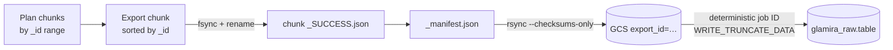

# Decision record: retry-safe, idempotent raw export

**Status:** accepted. The export (`export-raw`, `verify-export`) was implemented on 2026-11-17 and switched from Avro to Parquet parts on 2026-11-22 ([file-format decision](raw_file_format.md)); the protocol below is unchanged by the format. The GCS upload and the BigQuery load (`publish-export`, the `bigquery-loader` Cloud Function, `load-bigquery`; section 7) were implemented on 2026-11-18.
**Scope:** the export of the four raw tables in the [raw layer contract](../raw_layer_contract.md), their upload to GCS, and their load into BigQuery.

## Context

The export reads 45.6 M documents, 41.4 M of them events, and runs for about an hour. Several things must not force a restart from zero or duplicate data:
- a crash, an SSH drop or a transient MongoDB error late in `events`;
- an upload retry or a BigQuery load retry.

Two things could make outputs differ between runs: MongoDB's natural order is not stable, and file writers may embed run-specific metadata.

The design goals are:

| Property | Meaning here |
| --- | --- |
| Retry-safe | Any step can be rerun after any failure, with no manual cleanup |
| Resumable | A rerun skips work that is already committed and verified |
| Idempotent | The same inputs give the same files and, downstream, the same table, never duplicates |

## Decision

Every stage has three parts:
- a **deterministic unit of work**;
- a **commit marker** written last;
- **verification** of the committed work before it is skipped.

State is read only from files, never from logs.

### 1. Export identity

- `--export-id` names a run, which writes to `<output>/<export-id>/<table>/`.
- **Identity.** The first run writes `_export.json`. Its `identity` holds every input that decides the bytes:
  - the table;
  - the source namespace, collection UUID and per-chunk document counts;
  - the chunk plan;
  - the SHA-256 of the committed BigQuery schema, from which the Parquet schema derives;
  - the PII key fingerprint;
  - the codec and `rows_per_file`;
  - the Parquet format version, compression, row-group size and the pyarrow version.
- **Resume.** A rerun with the same identity resumes; a different identity is refused with the differing keys named. Context such as the start time, git SHA and server address is recorded but not compared, so a resume through another tunnel port works.
- **Concurrent runs.** A non-blocking `flock` on the table directory refuses a second process.
- **Worker count.** `--workers` is not part of the identity, because the output does not depend on it.

### 2. Chunks

| Table | Chunk | Rows per chunk |
| --- | --- | --- |
| `events` | One per UTC day of the `_id` ObjectId time, `[ObjectId(day), ObjectId(day + 1))` | 65 chunks of 0.2–0.9 M |
| `ip_locations`, `products`, `product_option_values` | One chunk, `all` | 3.2 M, 19.6 K, 0.9 M |
| Any table with `--limit N` | One chunk, `all`: the first N documents by `_id` | N |

- Every chunk is read with `find(range).sort("_id")` on the default `_id_` index, so no new index is needed.
- **Coverage check.** Before export, the per-chunk `count_documents` must add up to the collection count. This fails if any `_id` is not an ObjectId or falls outside the planned days.

### 3. Chunk commit protocol

1. If `chunk=<id>/_SUCCESS.json` exists, re-hash the parts. If they match, **skip** the chunk. A missing, changed or extra part stops the run.
2. Otherwise delete the chunk's leftover files. Only names the exporter writes are deleted; any other file stops the run.
3. Count the range, read it sorted by `_id`, convert each row, and write parts as `.tmp`, `fsync`, then rename.
4. Require the rows written to equal the range count both before and after the read.
5. Write `_SUCCESS.json` atomically. It holds the rows, the first and last `_id`, and each part's name, rows and SHA-256. **This file is the commit point.**

When every chunk is committed, `_manifest.json` is written. It records `content_sha256`, the SHA-256 over the sorted part names and hashes, without timestamps. Its presence means "complete", and rerunning a complete export does nothing.

| Crash point | Next run |
| --- | --- |
| During a part, or after some parts but before the marker | The chunk has no marker, so its files are deleted and the chunk is redone with the same bytes |
| During the marker write (`_SUCCESS.json.tmp`) | Same: deleted and redone |
| Power loss after the marker rename, before the directory `fsync` | Marker absent: redone. Marker present: valid, because the parts were fsynced first |
| After every marker, before the manifest | Chunks are verified and skipped, then the manifest is written |
| Log line missing or duplicated | No effect: logs are never read |

### 4. Byte-identical output

The same inputs always give the same bytes, from any process and with any worker count, because of three choices:
- rows within a chunk are sorted by `_id`;
- row groups always break at the same row counts (50,000 rows; a new part every 1,000,000);
- the Parquet footer holds only the writer version and the Arrow schema, with no timestamp or random field.

**How this is checked.** A unit test writes the same rows in four processes with different `PYTHONHASHSEED` values and requires one SHA-256. The integration tests require a 2-worker export to equal a single-process one byte for byte, and an interrupted run to resume to the same `content_sha256`. The earlier Avro writer needed a seeded sync marker and an unparsed schema in its header to get the same guarantee.

**What this makes possible:**
- a chunk can be compared to a committed one by hash alone;
- the GCS sync uploads nothing when nothing changed;
- `content_sha256` can serve as the content identity in the BigQuery job ID.

### 5. Retries and stopping

| Failure | Action |
| --- | --- |
| `AutoReconnect` (covers network and server-selection timeouts), `CursorNotFound` | Retry that chunk from step 2: 3 attempts, with a backoff of 5 s × 2ⁿ⁻¹ plus jitter |
| Contract violation, count or coverage mismatch, changed committed chunk, different identity | Stop with exit code 1; retrying cannot fix the data |
| `OSError`, such as a full disk | Stop with exit code 1; rerun the same command after fixing the cause |
| SIGINT, SIGTERM, SIGHUP | Stop with exit code 130. Open chunks stay uncommitted and are redone on the next run |

A crash therefore costs at most the open chunks: one day of events each, about 2.5 minutes of work.

### 6. Parallel chunks (`--workers N`)

Convert and write are CPU-bound Python, so chunks run in **spawned processes**, never threads or forks. Each worker:
- opens its own `MongoClient`;
- runs the same commit protocol as a single process.

**Stopping.** Workers ignore SIGINT. On a signal or the first failed chunk, the parent:
1. sets a shared stop event, which workers check between documents;
2. cancels the queued chunks;
3. waits for the running chunks to stop uncommitted;
4. re-raises the error.

### 7. Upload and BigQuery load

The upload and the load are built in the [warehouse package](../../src/glamira_pipeline/warehouse/README.md) and follow the same pattern as the export: units of work, a commit marker written last, and verification before skipping.

- **Upload (`publish-export`):**
  1. Verify the export.
  2. Upload, into `gs://<bucket>/raw/<table>/export_id=<export-id>/`, only the parts the manifest lists, then the schemas and the manifest. Every write is create-only (`if_generation_match=0`); an object that already exists must match by CRC32C.
  3. Write **`_load.json` last**. It is the load spec: the source URIs and sizes, the schema, partitioning and clustering, the row count and `content_sha256`.
  - Its presence means the table is complete in the bucket, and it is what triggers the load.
  - One prefix per export ID means a new export never overwrites an old one.
- **Trigger:** a Cloud Function on the bucket's finalize events.
  - It ignores everything except `_load.json`.
  - Eventarc delivers at least once, so every step below must be safe to repeat.
- **Load:**
  - **Job ID:** `load_<dataset>_<table>_<export-id>_<first 12 hex of content_sha256>`. A redelivery gets `409`, reads that job and waits for it. A job that failed with a transient reason is retried under `_r<n>`.
  - **Write disposition:** `WRITE_TRUNCATE_DATA` into the table created from the contract. It replaces the rows atomically and keeps the table's partitioning, clustering, modes and descriptions. `WRITE_TRUNCATE` would take the schema from the files.
  - **Sources:** the URIs listed in the spec, never a wildcard, so stray objects are never loaded. Each must exist with its recorded size.
- **After the load:** the table's row count must equal the spec. Only then is **`_LOADED.json`** written, so a later delivery stops before calling BigQuery.
- **Error classes:**
  - Transient (a job still running after 480 s, transient job or API errors): raised, so Eventarc redelivers, and the redelivery waits on the same job.
  - Permanent (bad spec, layout mismatch, missing part, failed job, count mismatch): logged and not retried. Fix the cause, then run `load-bigquery` on the same spec.
- **Not one load per day partition.** Chunks follow the `_id` day, and 166 events have a `time_stamp` on the neighbouring day, within 5 s of midnight. BigQuery would reject those rows from a single-partition load.

## Evidence

**Measured 2026-11-17 on the VM** (e2-standard-4, read-only probes on `countly.summary`):

| Probe | Result |
| --- | --- |
| ObjectId time − `time_stamp` | −1 s or 0 s on the 100K sample; the day differs for 166 of 41.4 M documents |
| `_id` range | 2020-04-01 → 2020-06-04 UTC: 65 day chunks covering all 41,432,473 documents |
| Counting all 65 chunks | 21 s (`COUNT_SCAN` on `_id_`) |
| Physical order | 44% of adjacent documents ascend by `_id`, so natural order is not `_id` order |

**Full runs:** see the [report](../reports/full_export.md).
- Every chunk committed on attempt 1.
- Reading by `_id` range is 13–14% of the work; convert and write dominate. The extra server cost of sorted reads therefore does not matter.
- With 3 workers: export 52 min 46 s, then `verify-export` 53 s.

**BigQuery behaviour:** taken from the documentation. The loader's handling of 409, transient failures and row counts is unit-tested against fakes; the first real loads are recorded in the load report.
- A load job is atomic ([batch loading](https://docs.cloud.google.com/bigquery/docs/batch-loading-data)).
- `WRITE_TRUNCATE_DATA` keeps the table schema ([Job reference](https://docs.cloud.google.com/bigquery/docs/reference/rest/v2/Job)).
- Client-chosen job IDs are idempotent ([reliability](https://docs.cloud.google.com/bigquery/docs/reliability-intro)).

## Alternatives rejected

| Alternative | Why not |
| --- | --- |
| Natural-order cursor resumed with `skip` | Natural order is not stable between runs, and `skip` rescans every skipped document |
| Resume token of a collection scan (`$_requestResumeToken`) | Internal, undocumented MongoDB option |
| Chunks by `time_stamp` | Needs a new index on 41 M documents; `_id` ranges are free |
| Chunks of a fixed document count | Boundaries would depend on read order; day ranges are fixed by the data |
| Threads instead of processes | Conversion is CPU-bound Python and would share one core |
| Decoding every part again inside the export | About 21 min per full run. The SHA-256 is computed while writing, and `verify-export` checks it and every Parquet footer in about a minute; decoding stays available as `--full` |
| Append loads plus dbt deduplication, or `MERGE` on `_id` | Moves duplicates downstream, or scans the whole target on every load; the export is a full snapshot |

## Consequences and limits

- **Library versions.** Byte identity holds only for the same pyarrow version and writer settings, which is why they are part of the identity.
- **Converter code is not part of the identity.** The identity covers the schema hash but not the conversion code. Resuming after a converter change would mix old and new chunks, so **start a new export ID after any change to `export/`**.
- **Parallel efficiency.** Three workers made `events` 2.06× faster, not 3×. On 4 shared vCPUs that `mongod` also uses, each worker ran about 30% slower. More speed needs more cores, or less Python work per row: convert is about 50% of the work.

## Implementation

| Module | Responsibility |
| --- | --- |
| [`export/chunks.py`](../../src/glamira_pipeline/export/chunks.py) | Day chunks of `_id`, per-chunk counts, coverage check |
| [`export/state.py`](../../src/glamira_pipeline/export/state.py) | Identity, chunk markers, verify-before-skip, reset of uncommitted chunks, `flock` |
| [`export/parquet_files.py`](../../src/glamira_pipeline/export/parquet_files.py) | Parquet parts in fixed row groups, deterministic bytes, SHA-256 while writing |
| [`export/exporter.py`](../../src/glamira_pipeline/export/exporter.py) | Table export, chunk retries, manifest |
| [`export/parallel.py`](../../src/glamira_pipeline/export/parallel.py) | Worker processes and coordinated stop |
| [`export/verify.py`](../../src/glamira_pipeline/export/verify.py) | `verify-export` |
| [`warehouse/`](../../src/glamira_pipeline/warehouse/README.md) | `publish-export`, the load spec, the idempotent BigQuery load, the Cloud Function |

**Tests**
- Unit tests:
  - [chunk plan and state](../../tests/unit/test_export_state.py): contiguous days, coverage, identical bytes under different hash seeds, marker verification, safe reset, identity, lock;
  - [verification](../../tests/unit/test_export_verify.py): missing, extra and `.tmp` parts, changed bytes, schema drift, `--full` row counts.
- [Integration](../../tests/integration/test_export_mongo.py), against a local MongoDB 8.0 with three days of synthetic events:
  - **Resume:** an interrupted run resumes to the same `content_sha256`.
  - **Retries:** a transient error is retried, and the run fails after 3 attempts.
  - **Refusals:** a tampered committed chunk and a changed identity are both refused.
  - **Determinism:** reverse insertion order gives the same output.
  - **Coverage:** a non-ObjectId `_id` fails the coverage check.
  - **Parallel equals single:** a parallel run gives the same bytes as a single-process run.
  - **Parallel stops:** a parallel interrupt or violation stops every worker, and the run resumes.
