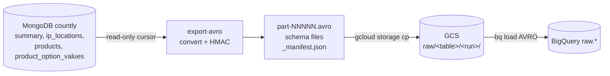

# Raw layer data contract: Avro files and BigQuery tables

**Status:** in force from 2026-11-17. **Applies to:** every file written by `export-avro` and every table in the BigQuery `raw` dataset.

The contract is code, not this page. Each table is declared once in [`tables.py`](../src/glamira_pipeline/export/tables.py). From that one declaration:

- the Avro schemas in [`schemas/raw/*.avsc`](../schemas/raw/) are generated;
- the BigQuery schemas in [`schemas/raw/*.bq.json`](../schemas/raw/) are generated, field descriptions included;
- the row converter is driven by the same declaration.

A unit test fails if the committed schema files differ from the declaration. The tables below are generated from the same source. Why the schema looks like this, including rejected alternatives, is in the [decision record](decisions/raw_events_schema.md).

## 1. Data flow



| Table | Source collection | Grain | Key | Rows (2026-11-17) | Partition / cluster |
| --- | --- | --- | --- | --- | --- |
| `raw.events` | `countly.summary` | One tracking event | `_id` | 41,432,473 | `DATE(time_stamp)` (65 days) / `collection` |
| `raw.ip_locations` | `countly.ip_locations` | One distinct valid IP | `ip_hash` | 3,239,627 | none (small) |
| `raw.products` | `countly.products` | One product ID referenced by events | `product_id` | 19,557 | none |
| `raw.product_option_values` | `countly.product_option_values` | One (product, option, value) | `product_id, option_id, value_id` | 923,294 | none |

Row counts are those of the source collections; an export must reproduce them exactly (section 6).

## 2. Type system

| Contract type | Avro type | BigQuery type | Notes |
| --- | --- | --- | --- |
| STRING | `string` | STRING | All identifiers, including numeric ones |
| INT64 | `long` | INT64 | |
| BOOL | `boolean` | BOOL | |
| NUMERIC | `bytes` + `decimal(38, 9)` | NUMERIC | Exact. (38, 9) is the widest Avro decimal BigQuery maps to NUMERIC; a value with more than 9 decimals fails the export |
| TIMESTAMP | `long` + `timestamp-micros` | TIMESTAMP | UTC microseconds. Requires `--use_avro_logical_types` when loading |
| RECORD | `record` (named) | STRUCT | Record names are unique per table |

| Mode | Avro | BigQuery | Empty value |
| --- | --- | --- | --- |
| REQUIRED | plain type | REQUIRED | A missing or null source value fails the export |
| NULLABLE | `["null", T]`, default `null` | NULLABLE | NULL (missing key and explicit null are not distinguished) |
| REPEATED | `array<T>`, default `[]` | REPEATED (ARRAY) | `[]` |

**When a field is REQUIRED:** for events, when it was present and non-null in all 41,432,473 documents. For the enrichment tables, only when the producing pipeline guarantees it: its MongoDB validator requires a non-null value. A REQUIRED column can be relaxed to NULLABLE later without a reload; the reverse is impossible.

## 3. Conversion rules

Raw keeps values; only representations change. Every rule other than `as_is` is counted per source path in the export manifest.

| Rule | Accepts | Produces | Anything else |
| --- | --- | --- | --- |
| `as_is` | Exactly the contract type (Decimal128 for NUMERIC, BSON date for TIMESTAMP) | Same value | Violation |
| `objectid_hex` | ObjectId | 24-char lowercase hex | Violation |
| `unix_seconds` | int | seconds × 1,000,000 (TIMESTAMP) | Violation |
| `integer_as_string` | string, int, integral double | string unchanged; number as decimal digits (`3571009023.0` → `"3571009023"`) | bool or non-integral number: violation |
| `bool_as_string` | string, bool | string unchanged; `false` → `"false"`, `true` → `"true"` | Violation |
| `int_as_bool` | bool, 0, 1 | bool; `0` → `false`, `1` → `true` | Any other int: violation |
| `number_as_decimal` | int, double, Decimal128 | exact decimal | Violation |
| `hmac` | string | HMAC-SHA256 hex (64 chars); `""` kept | Violation |
| `hmac_email` | string | HMAC of the trimmed, lower-cased value; `""` kept | Violation |
| `hmac_ip` | string | HMAC of the canonical IP (`ipaddress`), so `2001:DB8:0::1` and `2001:db8::1` match; an unparseable value is hashed as stored and counted | Violation |
| `array_form` | array of objects, or object | array → rows; object → `[]` (it goes to the `object_form` column) | Violation |
| `object_form` | object, or array | object → STRUCT; array → NULL | Violation |
| `empty_string_as_empty_array` | array of objects, or `""` | `""` → `[]` | Violation |

**Rules applied to every document**
- **Unknown keys are refused.** A key that is not in the contract fails the export, at the top level and inside every nested object.
- **Redundant `_id`.** In `products` and `product_option_values`, the source `_id` repeats the key fields. The converter checks that they are equal and then drops `_id`.
- **Violations stop the export.** The error names the table, the document number, the `_id` and the field path. For `ip_locations` the `_id` is left out, because it is a raw IP.

## 4. Personal data

Decided by the owner on 2026-11-16 (email, device ID) and 2026-11-17 (IP, customer ID).

| Source field | Raw column | Treatment |
| --- | --- | --- |
| `summary.email_address` | `events.email_hash` | `hmac_email` |
| `summary.device_id` | `events.device_id_hash` | `hmac` |
| `summary.ip` | `events.ip_hash` | `hmac_ip` |
| `summary.user_id_db` | `events.user_id_hash` | `hmac` (exactly as stored; `""` for the 95.19% anonymous events stays `""`) |
| `ip_locations._id` (the IP) | `ip_locations.ip_hash` | `hmac_ip`: same key and normalization, so `events.ip_hash = ip_locations.ip_hash` is the geolocation join |

- **Key:** `GLAMIRA_PII_HASH_KEY`, at least 32 random bytes as hex. Generate it with `python -c 'import secrets; print(secrets.token_hex(32))'`.
  - It lives only in the environment of the export run. It is never committed, logged or written next to the data.
  - It must be kept: an export with another key produces hashes that do not join with earlier ones.
- **Checking the key:** each manifest records `pii_key_fingerprint`, an HMAC of a fixed message. Equal fingerprints mean the hashes are comparable. The key cannot be recovered from the fingerprint.
- **Not pseudonymized:** `user_agent` (kept for browser, OS and device analysis in staging; `device_id_hash` already identifies the device), free text in `key_search`, and URLs. Keep the `raw` dataset restricted; column-level policy tags can be added later without a reload.

## 5. Tables

### 5.1 `raw.events`

Source: `countly.summary`, 27 event types. Source types are from the full scan of 41,432,473 documents on 2026-11-14.

**Field meanings**
- Event-specific fields are NULL outside the event types that send them; the [data dictionary](data_dictionary.md) lists which types send which field.
- The source `option` has two shapes, and they go to different columns:
  - the **array form** in product events → `option`;
  - the **object form** in listing events → `option_filter`.
- Real examples of each nested type are in the [decision record](decisions/raw_events_schema.md#complex-types-and-why-they-are-needed).

| Column | BigQuery | Mode | Avro | Source field | Source types (observed) | Rule | Meaning |
| --- | --- | --- | --- | --- | --- | --- | --- |
| `_id` | STRING | REQUIRED | `string` | `_id` | objectId 41.43 M | `objectid_hex` | Event ID: source ObjectId as 24 hex chars |
| `collection` | STRING | REQUIRED | `string` | `collection` | string 41.43 M | — | Event type, e.g. view_product_detail |
| `time_stamp` | TIMESTAMP | REQUIRED | `timestamp-micros` | `time_stamp` | int 41.43 M | `unix_seconds` | Event time (UTC) from Unix seconds |
| `api_version` | STRING | REQUIRED | `string` | `api_version` | string 41.43 M | — | Tracker API version |
| `store_id` | STRING | REQUIRED | `string` | `store_id` | string 41.43 M | — | Glamira store ID (digits) |
| `current_url` | STRING | REQUIRED | `string` | `current_url` | string 41.43 M | — | Page URL |
| `referrer_url` | STRING | REQUIRED | `string` | `referrer_url` | string 41.43 M | — | Referrer URL; '' for direct entries |
| `ip_hash` | STRING | REQUIRED | `string` | `ip` | string 41.43 M | `hmac_ip` | HMAC-SHA256 of the normalized client IP; joins ip_locations.ip_hash |
| `device_id_hash` | STRING | REQUIRED | `string` | `device_id` | string 41.43 M | `hmac` | HMAC-SHA256 of the device ID |
| `user_id_hash` | STRING | REQUIRED | `string` | `user_id_db` | string 41.43 M | `hmac` | HMAC-SHA256 of the customer ID; '' for anonymous visits (95.19%) |
| `user_agent` | STRING | REQUIRED | `string` | `user_agent` | string 41.43 M | — | Browser user agent |
| `local_time` | STRING | NULLABLE | `null \| string` | `local_time` | string 41.43 M, null 240 | — | Client local time as sent, e.g. '2020-05-20 3:6:40' |
| `resolution` | STRING | NULLABLE | `null \| string` | `resolution` | string 41.43 M, null 240 | — | Screen resolution as sent |
| `email_hash` | STRING | NULLABLE | `null \| string` | `email_address` | string 41.43 M, null 397 | `hmac_email` | HMAC-SHA256 of the trimmed, lower-cased email; '' when not given |
| `show_recommendation` | STRING | NULLABLE | `null \| string` | `show_recommendation` | string 33.67 M, null 7.77 M | — | 'true'/'false' as sent; a few malformed values |
| `product_id` | STRING | NULLABLE | `null \| string` | `product_id` | string 22.24 M | — | Product of a product event |
| `viewing_product_id` | STRING | NULLABLE | `null \| string` | `viewing_product_id` | string 1.99 M | — | Product page on which a recommendation was shown |
| `recommendation_product_id` | STRING | NULLABLE | `null \| string` | `recommendation_product_id` | string 217,700, null 25,596 | — | Recommended product |
| `recommendation_clicked_position` | INT64 | NULLABLE | `null \| long` | `recommendation_clicked_position` | int 179,226, null 25,547 | — | Clicked slot (always 0 observed) |
| `recommendation_product_position` | STRING | NULLABLE | `null \| string` | `recommendation_product_position` | int 20,128, string 18,344, null 51 | `integer_as_string` | Slot of the recommended product; int or string in the source |
| `recommendation` | BOOL | NULLABLE | `null \| boolean` | `recommendation` | bool 10.94 M, null 68 | — | Recommendation flag (only false observed) |
| `utm_source` | STRING | NULLABLE | `null \| string` | `utm_source` | bool 10.86 M, string 88,179, null 68 | `bool_as_string` | Campaign source; source false becomes 'false' |
| `utm_medium` | STRING | NULLABLE | `null \| string` | `utm_medium` | bool 10.85 M, string 90,721, null 68 | `bool_as_string` | Campaign medium; source false becomes 'false' |
| `cat_id` | STRING | NULLABLE | `null \| string` | `cat_id` | null 12.04 M, string 258 | — | Category ID of a listing page |
| `collect_id` | STRING | NULLABLE | `null \| string` | `collect_id` | string 12.04 M | — | Collection ID of a listing page |
| `key_search` | STRING | NULLABLE | `null \| string` | `key_search` | null 163,108, string 75,200 | — | Search text (search_box_action) |
| `price` | STRING | NULLABLE | `null \| string` | `price` | string 186,590, null 1,311 | — | Locale-formatted price (add_to_cart_action) |
| `currency` | STRING | NULLABLE | `null \| string` | `currency` | string 186,590, null 1,311 | — | Currency symbol (add_to_cart_action) |
| `is_paypal` | BOOL | NULLABLE | `null \| boolean` | `is_paypal` | null 186,592, bool 1,309 | — | PayPal express checkout (only true observed) |
| `order_id` | STRING | NULLABLE | `null \| string` | `order_id` | string 88,540, int 16,116, double 9,963 | `integer_as_string` | Order number (checkout_success); '' in checkout |
| `option` | ARRAY<STRUCT> | REPEATED | `array<OptionItem>` | `option` | array 22.21 M, object 12.09 M | `array_form` | Chosen product options: the array form of the source 'option' |
| `option_filter` | STRUCT | NULLABLE | `null \| OptionFilter` | `option` | array 22.21 M, object 12.09 M | `object_form` | Listing filter state: the object form of the source 'option' |
| `cart_products` | ARRAY<STRUCT> | REPEATED | `array<CartProduct>` | `cart_products` | array 457,696 | — | Cart lines (cart and checkout events) |

**`option` — Avro record `OptionItem`**

| Column | BigQuery | Mode | Avro | Source field | Source types (observed) | Rule | Meaning |
| --- | --- | --- | --- | --- | --- | --- | --- |
| `option[].option_label` | STRING | NULLABLE | `null \| string` | `option[].option_label` | string 33.46 M | — | Option name, e.g. alloy, diamond, stone/diamonds |
| `option[].option_id` | STRING | NULLABLE | `null \| string` | `option[].option_id` | string 33.28 M | — | Product option ID; joins product_option_values.option_id |
| `option[].value_label` | STRING | NULLABLE | `null \| string` | `option[].value_label` | string 33.46 M | — | Selected value label |
| `option[].value_id` | STRING | NULLABLE | `null \| string` | `option[].value_id` | string 33.39 M | — | Selected value ID; joins product_option_values.value_id |
| `option[].quality` | STRING | NULLABLE | `null \| string` | `option[].quality` | string 2.23 M | — | Stone quality code (select_product_option_quality only) |
| `option[].quality_label` | STRING | NULLABLE | `null \| string` | `option[].quality_label` | string 1.93 M | — | Stone quality label (select_product_option_quality only) |

**`option_filter` — Avro record `OptionFilter`**

| Column | BigQuery | Mode | Avro | Source field | Source types (observed) | Rule | Meaning |
| --- | --- | --- | --- | --- | --- | --- | --- |
| `option_filter.alloy` | STRING | NULLABLE | `null \| string` | `option.alloy` | string 12.09 M | — | Metal filter |
| `option_filter.diamond` | STRING | NULLABLE | `null \| string` | `option.diamond` | string 12.06 M | — | Stone filter |
| `option_filter.shapediamond` | STRING | NULLABLE | `null \| string` | `option.shapediamond` | string 12.06 M | — | Stone shape filter |
| `option_filter.stone` | STRING | NULLABLE | `null \| string` | `option.stone` | string 33,664 | — | Stone filter (view_all_recommend) |
| `option_filter.price` | STRING | NULLABLE | `null \| string` | `option.price` | string 33,664 | — | Price filter (view_all_recommend) |
| `option_filter.finish` | STRING | NULLABLE | `null \| string` | `option.finish` | string 33,664 | — | Finish filter (view_all_recommend) |
| `option_filter.pearlcolor` | STRING | NULLABLE | `null \| string` | `option.pearlcolor` | string 33,664 | — | Pearl colour filter (view_all_recommend) |
| `option_filter.kollektion` | STRING | NULLABLE | `null \| string` | `option.Kollektion` | string 33,664 | — | Collection filter; source key 'Kollektion' |
| `option_filter.kollektion_id` | STRING | NULLABLE | `null \| string` | `option.kollektion_id` | string 33,664 | — | Collection ID filter (view_all_recommend) |
| `option_filter.category_id` | STRING | NULLABLE | `null \| string` | `option.category id` | string 33,664 | — | Category filter; source key 'category id' |

**`cart_products` — Avro record `CartProduct`**

| Column | BigQuery | Mode | Avro | Source field | Source types (observed) | Rule | Meaning |
| --- | --- | --- | --- | --- | --- | --- | --- |
| `cart_products[].product_id` | STRING | NULLABLE | `null \| string` | `cart_products[].product_id` | int 822,438 | `integer_as_string` | Product ID; int in the source |
| `cart_products[].amount` | INT64 | NULLABLE | `null \| long` | `cart_products[].amount` | int 160,181 | — | Quantity (checkout, checkout_success); -1 to 9,999 observed |
| `cart_products[].price` | STRING | NULLABLE | `null \| string` | `cart_products[].price` | string 35,065 | — | Locale-formatted unit price (checkout_success), e.g. '55,00' |
| `cart_products[].currency` | STRING | NULLABLE | `null \| string` | `cart_products[].currency` | string 35,065 | — | Currency symbol (checkout_success), e.g. '€' |
| `cart_products[].option` | ARRAY<STRUCT> | REPEATED | `array<CartOption>` | `cart_products[].option` | array 673,929, string 148,509 | `empty_string_as_empty_array` | Chosen options; the source string '' becomes an empty array |

**`option` — Avro record `CartOption`**

| Column | BigQuery | Mode | Avro | Source field | Source types (observed) | Rule | Meaning |
| --- | --- | --- | --- | --- | --- | --- | --- |
| `cart_products[].option[].option_id` | STRING | NULLABLE | `null \| string` | `cart_products[].option[].option_id` | int 1.13 M | `integer_as_string` | Option ID; int in the source |
| `cart_products[].option[].option_label` | STRING | NULLABLE | `null \| string` | `cart_products[].option[].option_label` | string 1.13 M | — | Option name |
| `cart_products[].option[].value_id` | STRING | NULLABLE | `null \| string` | `cart_products[].option[].value_id` | int 1.13 M | `integer_as_string` | Value ID; int in the source |
| `cart_products[].option[].value_label` | STRING | NULLABLE | `null \| string` | `cart_products[].option[].value_label` | string 1.13 M | — | Selected value label |

### 5.2 `raw.ip_locations`

Source: `countly.ip_locations`, written by `enrich-ip-locations` (offline IP2Location DB3 BIN dated 2016-11-29). Source types measured on 2026-11-17 over all 3,239,627 documents.

| Column | BigQuery | Mode | Avro | Source field | Source types (observed) | Rule | Meaning |
| --- | --- | --- | --- | --- | --- | --- | --- |
| `ip_hash` | STRING | REQUIRED | `string` | `_id` | string 3.24 M | `hmac_ip` | HMAC-SHA256 of the normalized IP; joins events.ip_hash |
| `ip_version` | INT64 | REQUIRED | `long` | `ip_version` | int 3.24 M | — | 4 or 6 |
| `status` | STRING | REQUIRED | `string` | `status` | string 3.24 M | — | resolved, no_match, not_public, unsupported_ipv6 or lookup_failed |
| `country_code` | STRING | NULLABLE | `null \| string` | `country_code` | string 3.20 M, null 38,241 | — | ISO 3166-1 alpha-2; null unless resolved |
| `country_name` | STRING | NULLABLE | `null \| string` | `country_name` | string 3.20 M, null 38,241 | — | Country name; null unless resolved |
| `region` | STRING | NULLABLE | `null \| string` | `region` | string 3.20 M, null 40,075 | — | Region; null when unknown |
| `city` | STRING | NULLABLE | `null \| string` | `city` | string 3.20 M, null 40,075 | — | City; null when unknown |
| `database_id` | STRING | REQUIRED | `string` | `database_id` | string 3.24 M | — | SHA-256 of the IP2Location BIN used |

### 5.3 `raw.products`

Source: `countly.products`, written by `crawl-products` from the 2026 catalog. These prices are not the prices of the 2020 events. Source types measured on 2026-11-17 over all 19,557 documents. The source `_id` equals `product_id` and is dropped.

| Column | BigQuery | Mode | Avro | Source field | Source types (observed) | Rule | Meaning |
| --- | --- | --- | --- | --- | --- | --- | --- |
| `product_id` | STRING | REQUIRED | `string` | `product_id` | string 19,557 | — | Product ID, same form as events.product_id |
| `status` | STRING | REQUIRED | `string` | `status` | string 19,557 | — | success, not_found, error or blocked |
| `status_code` | INT64 | NULLABLE | `null \| long` | `status_code` | int 19,557 | — | HTTP status; null on a network error |
| `attempts` | INT64 | REQUIRED | `long` | `attempts` | int 19,557 | — | Crawl attempts |
| `error` | STRING | NULLABLE | `null \| string` | `error` | null 19,557 | — | Error message of a failed attempt |
| `name` | STRING | NULLABLE | `null \| string` | `name` | string 19,121, null 436 | — | Product name |
| `sku` | STRING | NULLABLE | `null \| string` | `sku` | string 19,121, null 436 | — | SKU |
| `attribute_set_id` | STRING | NULLABLE | `null \| string` | `attribute_set_id` | int 19,121, null 436 | `integer_as_string` | Attribute set ID |
| `attribute_set` | STRING | NULLABLE | `null \| string` | `attribute_set` | string 19,121, null 436 | — | Attribute set name |
| `type_id` | STRING | NULLABLE | `null \| string` | `type_id` | string 19,121, null 436 | — | simple, product_set, virtual or deposit |
| `product_type` | STRING | NULLABLE | `null \| string` | `product_type` | string 19,121, null 436 | — | ring, wedding_ring, pendant, ... |
| `product_type_value` | STRING | NULLABLE | `null \| string` | `product_type_value` | string 19,065, null 492 | — | Product type code |
| `collection` | STRING | NULLABLE | `null \| string` | `collection` | string 19,121, null 436 | — | Collection name |
| `collection_id` | STRING | NULLABLE | `null \| string` | `collection_id` | string 18,471, null 1,086 | — | Collection ID |
| `category` | STRING | NULLABLE | `null \| string` | `category` | int 18,968, null 436, string 153 | `integer_as_string` | Category ID; usually '0' |
| `category_name` | STRING | NULLABLE | `null \| string` | `category_name` | string 19,121, null 436 | — | Category name |
| `gender` | STRING | NULLABLE | `null \| string` | `gender` | string 14,324, bool 4,797, null 436 | `bool_as_string` | women, men, or 'false' when the site sends false |
| `price` | NUMERIC | NULLABLE | `null \| decimal(38,9)` | `price` | decimal 19,120, null 437 | — | Price in currency, tax included |
| `min_price` | NUMERIC | NULLABLE | `null \| decimal(38,9)` | `min_price` | decimal 18,639, null 918 | — | Lowest configurable price |
| `max_price` | NUMERIC | NULLABLE | `null \| decimal(38,9)` | `max_price` | decimal 18,639, null 918 | — | Highest configurable price |
| `min_price_format` | STRING | NULLABLE | `null \| string` | `min_price_format` | string 19,121, null 436 | — | Formatted lowest price |
| `max_price_format` | STRING | NULLABLE | `null \| string` | `max_price_format` | string 19,121, null 436 | — | Formatted highest price |
| `full_price` | NUMERIC | NULLABLE | `null \| decimal(38,9)` | `full_price` | decimal 19,121, null 436 | — | List price |
| `sale_price` | NUMERIC | NULLABLE | `null \| decimal(38,9)` | `sale_price` | decimal 19,121, null 436 | — | Sale price |
| `full_price_format` | STRING | NULLABLE | `null \| string` | `full_price_format` | string 19,121, null 436 | — | Formatted list price |
| `sale_price_format` | STRING | NULLABLE | `null \| string` | `sale_price_format` | string 19,121, null 436 | — | Formatted sale price |
| `currency` | STRING | NULLABLE | `null \| string` | `currency` | string 19,121, null 436 | — | ISO currency code, e.g. USD |
| `include_tax` | BOOL | NULLABLE | `null \| boolean` | `include_tax` | bool 19,121, null 436 | — | Whether prices include tax |
| `default_tax` | NUMERIC | NULLABLE | `null \| decimal(38,9)` | `default_tax` | int 19,121, null 436 | `number_as_decimal` | Default tax rate |
| `current_tax` | NUMERIC | NULLABLE | `null \| decimal(38,9)` | `current_tax` | int 19,121, null 436 | `number_as_decimal` | Current tax rate |
| `use_gold_price` | BOOL | NULLABLE | `null \| boolean` | `use_gold_price` | bool 19,121, null 436 | — | Price follows the gold price |
| `option_count` | INT64 | NULLABLE | `null \| long` | `option_count` | int 19,121, null 436 | — | Number of configurable options |
| `source` | STRUCT | REQUIRED | `ProductSource` | `source` | object 19,557 | — | Storefront request that produced the row |
| `run_id` | STRING | REQUIRED | `string` | `run_id` | string 19,557 | — | Crawl run ID (enrichment_runs) |
| `crawled_at` | TIMESTAMP | REQUIRED | `timestamp-micros` | `crawled_at` | date 19,557 | — | Crawl time (UTC) |

**`source` — Avro record `ProductSource`**

| Column | BigQuery | Mode | Avro | Source field | Source types (observed) | Rule | Meaning |
| --- | --- | --- | --- | --- | --- | --- | --- |
| `source.host` | STRING | REQUIRED | `string` | `source.host` | string 19,557 | — | Storefront host that answered |
| `source.store_code` | STRING | REQUIRED | `string` | `source.store_code` | string 19,557 | — | Storefront code |
| `source.url` | STRING | REQUIRED | `string` | `source.url` | string 19,557 | — | Requested react_data URL |
| `source.requested_currency` | STRING | REQUIRED | `string` | `source.requested_currency` | string 19,557 | — | Currency requested |

### 5.4 `raw.product_option_values`

Source: `countly.product_option_values`. Source types measured on 2026-11-17 over all 923,294 documents. The source `_id` is `{product_id, option_id, value_id}` and is dropped.

| Column | BigQuery | Mode | Avro | Source field | Source types (observed) | Rule | Meaning |
| --- | --- | --- | --- | --- | --- | --- | --- |
| `product_id` | STRING | REQUIRED | `string` | `product_id` | string 923,294 | — | Product ID |
| `option_id` | STRING | REQUIRED | `string` | `option_id` | string 923,294 | — | Option ID; joins events option[].option_id |
| `value_id` | STRING | NULLABLE | `null \| string` | `value_id` | string 888,623, null 34,671 | — | Value ID; null for free-text options such as engraving |
| `part_type` | STRING | NULLABLE | `null \| string` | `part_type` | string 809,378, null 113,916 | — | Part, e.g. stone1, alloy |
| `option_type` | STRING | NULLABLE | `null \| string` | `option_type` | string 923,294 | — | alloy, stone, engraving_font, ... |
| `option_title` | STRING | NULLABLE | `null \| string` | `option_title` | string 923,294 | — | Option title in the store language |
| `option_default_title` | STRING | NULLABLE | `null \| string` | `option_default_title` | string 923,294 | — | Option default title |
| `is_require` | BOOL | NULLABLE | `null \| boolean` | `is_require` | int 923,294 | `int_as_bool` | Option is mandatory; source 0/1 |
| `sort_order` | STRING | NULLABLE | `null \| string` | `sort_order` | string 923,294 | `integer_as_string` | Display order as served |
| `value_sku` | STRING | NULLABLE | `null \| string` | `value_sku` | string 814,866, null 108,428 | — | Value token used in product URLs |
| `value_title` | STRING | NULLABLE | `null \| string` | `value_title` | string 923,294 | — | Value title |
| `value_default_title` | STRING | NULLABLE | `null \| string` | `value_default_title` | string 888,623, null 34,671 | — | Value default title |
| `value_store_title` | STRING | NULLABLE | `null \| string` | `value_store_title` | string 905,449, null 17,845 | — | Value title in the store |
| `is_default` | BOOL | NULLABLE | `null \| boolean` | `is_default` | bool 895,890, null 18,358, int 9,046 | `int_as_bool` | Default value; source bool or 0 |
| `value_price` | NUMERIC | NULLABLE | `null \| decimal(38,9)` | `value_price` | decimal 888,623, null 34,671 | — | Price surcharge of the value |
| `price_type` | STRING | NULLABLE | `null \| string` | `price_type` | string 888,623, null 34,671 | — | fixed, percent or abs |
| `run_id` | STRING | REQUIRED | `string` | `run_id` | string 923,294 | — | Crawl run ID |
| `crawled_at` | TIMESTAMP | REQUIRED | `timestamp-micros` | `crawled_at` | date 923,294 | — | Crawl time (UTC) |

### 5.5 Join keys

| Join | Notes |
| --- | --- |
| `events.ip_hash = ip_locations.ip_hash` | Hash of the canonical IP on both sides. Events with an unparseable IP (6 in the full data) have no match |
| `events.product_id` (or `viewing_product_id`, `cart_products[].product_id`) `= products.product_id` | All STRING; cart IDs were ints in the source |
| `events.option[].option_id / value_id = product_option_values.option_id / value_id` | Also `cart_products[].option[]`. The catalog is from 2026, so some 2020 values no longer exist |

## 6. Export run: files and checks

```bash
export GLAMIRA_PII_HASH_KEY=...   # the project key, from a secret store
uv run export-avro --table all --output-dir /data/exports --export-id 2026-11-17 --workers 3
```

**Rerunning the same command resumes the export.** Committed chunks are verified and skipped; only uncommitted work is redone. The design is in the [retry and idempotency decision record](decisions/export_retry_idempotency.md).

| Option | Default | Meaning |
| --- | --- | --- |
| `--table` | required | `events`, `ip_locations`, `products`, `product_option_values` or `all`; can be repeated |
| `--output-dir` | required | Export root |
| `--export-id` | required | Name of this export; files go to `<output-dir>/<export-id>/<table>/`. The same ID with other inputs is refused |
| `--database` | `countly` | Source database |
| `--limit N` | all | First N documents by `_id`, as one chunk. The manifest labels this a non-random sample |
| `--rows-per-file` | 1,000,000 | Rows per Avro part |
| `--workers` | 1 | Processes exporting chunks in parallel, each with its own MongoDB client. The output does not depend on it, and a resume may use another value. On the 4-vCPU VM, use 3 and leave a core for `mongod` |

**Output per table**

```text
<output-dir>/<export-id>/<table>/
  _export.json                  identity: source UUID, chunk plan and counts, schema SHA, key fingerprint, versions
  <table>.avsc, <table>.bq.json Avro schema the parts were written with; BigQuery schema of the target table
  chunk=<id>/part-00000.avro    deflate-compressed rows of one chunk, sorted by _id
  chunk=<id>/_SUCCESS.json      chunk commit marker: rows, first and last _id, SHA-256 of each part
  _manifest.json                written last; its presence means "complete"
```

`events` has one chunk per UTC day of the `_id` ObjectId time (65 chunks in the full data). The other tables are one chunk, `all`.

**What makes an export correct**
1. Every document passes the contract, or the export stops at the first violation. The chunk gets no marker and the table no manifest.
2. Each part is written as `.tmp` and renamed after `fsync`. A chunk is committed only by its marker, written after all its parts. An interrupted run (SIGINT, SIGTERM, SIGHUP; exit code 130) leaves the open chunk uncommitted, and the next run deletes and redoes it.
3. Before exporting, the per-chunk counts must add up to the collection count. Each chunk must write exactly as many rows as its range held before and after the read.
4. The output is deterministic: rows sorted by `_id`, a sync marker derived from the part name, and a header that embeds the schema exactly as declared give the same bytes for the same inputs, whichever process or worker count wrote them.
5. Each part's SHA-256 is computed while it is written and recorded in the chunk marker and the manifest. The export does not re-read its own output; `verify-export` checks it later (below).

**Verifying an export later**, for example after it was moved or before it is uploaded:

```bash
uv run verify-export /data/exports/2026-11-17          # every table; or one table directory
uv run verify-export /data/exports/2026-11-17/events --full
```

| Check | Default | `--full` |
| --- | --- | --- |
| Inventory both ways: every listed part exists; no extra part, `.tmp` file or unknown `chunk=` directory | yes | yes |
| Size and SHA-256 of every part, and `content_sha256` | yes | yes |
| `avro_schema_sha256` equals the committed `schemas/raw/<table>.avsc` and the schema copy in the export | yes | yes |
| Decode every record; writer schema and row count per part | no | yes |

The default never decodes rows: the SHA-256 covers every byte that was counted and checked when the part was written. On the 100K sample it takes 0.1 s against 1.6 s with `--full`. Use `--full` to test the Avro library itself, for example after upgrading fastavro. Exit code 1 means the directory differs from its manifest or from the contract.

**Retries:** `AutoReconnect` (including network and server-selection timeouts) and `CursorNotFound` retry the open chunk up to 3 times, with exponential backoff and jitter. Any other error stops the run; rerun the same command after fixing the cause.

**What the manifest records**
- The export ID, the source namespace and collection UUID, and the document count.
- The selection (full collection, or a labelled sample).
- Per chunk: rows, number of parts and the attempt that committed it. Per part: name, rows, bytes and SHA-256.
- `content_sha256`, a hash over all parts that ignores timestamps.
- Conversion counts per path, the Avro schema SHA-256, and the PII key fingerprint.
- The git SHA, timestamps, and time spent reading, converting and writing.

**Measured performance** (full run on the project VM, 2026-11-17; [report](reports/full_export_avro.md)):
- All four tables: 45,614,951 rows, 9.30 GB, 2 h 06 min wall time, 0 violations, no retries.
- `events`: 1 h 41 min of export work, about 6,800 rows/s on one core. Convert takes 47%, write 39% and read 14%.
- Verification of `events` adds about 20 min.

**Exit codes**

| Code | Meaning |
| --- | --- |
| `0` | Success, or the export was already complete |
| `1` | Configuration, contract violation, count or coverage mismatch, changed committed chunk, other inputs for the same export ID, MongoDB or file error |
| `130` | Interrupted; rerun to resume |

## 7. Loading into BigQuery

Create each table from its committed schema, upload the export, then load the parts listed in the manifest. Shown for `events`; the other tables omit partitioning and clustering.

```bash
bq mk --table \
  --schema=schemas/raw/events.bq.json \
  --time_partitioning_field=time_stamp --time_partitioning_type=DAY \
  --clustering_fields=collection \
  <project>:raw.events

gcloud storage rsync --recursive --checksums-only \
  /data/exports/2026-11-17/events gs://<bucket>/raw/events/export_id=2026-11-17/

bq load --source_format=AVRO --use_avro_logical_types --decimal_target_types=NUMERIC \
  <project>:raw.events "$(jq -r '[.files[].name | "gs://<bucket>/raw/events/export_id=2026-11-17/" + .] | join(",")' \
  /data/exports/2026-11-17/events/_manifest.json)"
```

- `--use_avro_logical_types` is mandatory. Without it, BigQuery reads `timestamp-micros` as INTEGER, which does not match the TIMESTAMP columns.
- Upload only after `_manifest.json` exists. Because the parts are byte-identical across reruns, `rsync --checksums-only` uploads nothing that is already there.
- Loading the listed parts, not a wildcard, keeps manifests, markers and stray objects out of the load.
- **Reloading the same export:** loading the same files twice with the default append duplicates rows. The planned loader uses a deterministic job ID and `WRITE_TRUNCATE_DATA` instead ([decision record](decisions/export_retry_idempotency.md), section 7); it is not built yet.
- **Not yet verified:** one test load of a small export. It should confirm the REQUIRED/NULLABLE handling, empty arrays, the NULL STRUCT and NUMERIC in BigQuery.

## 8. Changing the contract

1. Edit the table declaration in `tables.py`, together with its converter rule if a new rule is needed.
2. Run `uv run write-raw-schemas`, then the unit tests. The schema-file test fails until the files are regenerated.
3. Prefer additive changes:
   - **New NULLABLE column, or a new field inside a STRUCT:** append it in BigQuery with `bq update`. Old files stay valid.
   - **REQUIRED → NULLABLE:** allowed in place.
   - **Rename, type change, or NULLABLE → REQUIRED:** needs a new table and a full re-export.
4. Record why in the decision record, and update this page.

## 9. Known limitations

- **CPU-bound export.** About 6,800 rows/s per worker on the VM. Chunks run in parallel with `--workers`; the speed-up is bounded by the VM's cores, the largest day (893,200 rows) and `mongod` sharing the CPU. A crash costs at most the chunks that were open (one day each, up to about 2.5 min of work).
- **Lost distinctions.** Missing key vs explicit null, `""` vs `[]` in cart options, int vs double `order_id`, bool `false` vs string `"false"`. Each conversion is counted, so the counts are auditable. Details are in the decision record.
- **Different time frames.** Enrichment data is from 2026 (catalog) and 2016 (IP database), while events are from 2020-04-01 to 2020-06-04.
- **Not yet loaded.** The full export completed with 0 contract violations, but it has not been loaded into BigQuery, and the full output has not been scanned for raw PII (only the 100K sample was).
