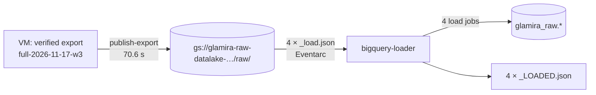

# BigQuery load of the raw layer: measured result

**Observed:** 2026-11-18 (UTC), in project region `asia-southeast1`.
**Outcome:** all four raw tables are in BigQuery dataset `glamira_raw`: 45,614,951 rows, 25.03 GB logical. Every check matches the export:
- exactly one load job per table;
- row counts equal to the manifests;
- 65 / 65 day counts equal to the export chunks.

The full export was published in **1 min 11 s**, and the Cloud Function had loaded all four tables **36 s** later.

How it works is in the [warehouse guide](../../src/glamira_pipeline/warehouse/README.md); the steps are in the [runbook](../runbooks/bigquery_load.md).

## 1. What ran

| Run | Source | Target | Purpose |
| --- | --- | --- | --- |
| **Sample** | `sample-100k`: 100,000 events from 2020-06-04, exported locally | `glamira_raw_sample.events` | Confirm types, modes, arrays and the trigger before the full load |
| **Full** | `full-2026-11-17-w3`, the verified full export, on the VM | `glamira_raw.{events, ip_locations, products, product_option_values}` | The raw layer |

## 2. Results: sample against full

| | Sample | Full |
| --- | ---: | ---: |
| Objects uploaded / skipped | 5 / 0 | 87 / 0 |
| Bytes uploaded | 22.4 MB | 9.30 GB |
| `publish-export` wall time, including the SHA-256 verification | 3.2 s | **70.6 s** (verify about 51 s, upload of `events` about 16 s) |
| Peak memory of `publish-export` | — | 1.5 GB (8 upload workers) |
| Load jobs | 1 | **4, one per table**, all `DONE`, no retry job (`_r2`) |
| Rows loaded | 100,000 | 45,614,951 |
| BigQuery storage (logical) | 0.06 GB | 25.03 GB |
| From the last upload to the last `_LOADED.json` | — | 36 s |

**Load jobs of the full run** (server time):

| Table | Rows | Input bytes | Job time |
| --- | ---: | ---: | ---: |
| `events` | 41,432,473 | 9,130,258,357 | 29.1 s |
| `ip_locations` | 3,239,627 | 145,046,620 | 11.3 s |
| `product_option_values` | 923,294 | 20,696,748 | 10.3 s |
| `products` | 19,557 | 1,492,459 | 1.9 s |

## 3. Verification

The queries are in [`sql/checks/`](../../sql/checks/).

| Check | Expected | Sample | Full |
| --- | --- | --- | --- |
| Row count per table (`01`) | Manifest rows | 100,000 | events 41,432,473; ip_locations 3,239,627; products 19,557; product_option_values 923,294 |
| Layout (`02`) | `events` partitioned by DAY on `time_stamp` and clustered by `collection`; REQUIRED modes kept | Yes, 13 non-nullable columns (11 REQUIRED + 2 REPEATED) | Yes; the non-nullable counts equal the contract: events 13, ip_locations 4, products 6, product_option_values 4 |
| Rows per `_id` day (`03`) | Equal to the export chunk rows | 1 day, 100,000 | **65 / 65 days equal** to `_manifest.json`. 166 rows have `time_stamp` on another day, as measured before the export |
| Listing filter (`04`) | `option_filter` set, `option` empty; equal to the export's `object -> option_filter` count | 26,066 = 26,066 | 12,092,054 = 12,092,054 |
| Empty cart option arrays (`04`) | Equal to the export's `'' -> []` count | 43 | 148,509 |
| Event time range (`04`) | 2020-04-01 00:00:01 → 2020-06-04 10:21:32 UTC | Within 2020-06-04 | Exactly that |
| NUMERIC (`05`) | 19,120 non-null `price`; 888,623 non-null `value_price` | — | 19,120 (0 to 13,217); 888,623 (−44 to 1,630,218) |
| Geolocation join (`06`) | About 98.88% of events, from IP enrichment | — | **98.88%** of events have a resolved location |
| Product attributes join (`06`) | About 1.54% of references missing | — | **1.54%** of `events.product_id` rows have no attributes |

The joins confirm that the HMAC keys agree across tables. `events.ip_hash` and `ip_locations.ip_hash` were hashed separately, with the same key and normalization, and they reproduce the coverage measured on the raw IPs in MongoDB.

## 4. Repeats and failures observed

- **A repeated upload does nothing.** Publishing the sample again uploaded 0 objects and skipped 5, so no new event was sent.
- **The first trigger was refused.**
  - The function's service account had no Cloud Run Invoker role, so Eventarc's first deliveries got 403.
  - After the role was granted, Eventarc's redelivery ran the load with no manual step. It created one job, and its `_LOADED.json` was written 11 minutes after the upload.
- **Duplicate deliveries.**
  - Two identical Eventarc triggers existed on the bucket, so every object was delivered twice.
  - For `events`, both deliveries ran at the same moment and logged `loaded` one second apart. BigQuery holds **one** job: the second delivery got 409 and waited for the first.
  - Later deliveries logged `already_loaded`. No row was duplicated.
- **Cold-start back-pressure.** About 174 events (87 objects × 2 triggers) arrived within 11 s. A few got "aborted after waiting too long for an available instance" and were redelivered. The idempotent design absorbs this, but one trigger halves the load.
- **Runbook fix.** gcloud rejected the short scope name `devstorage.read_write`. The runbook now passes full scope URLs.

## 5. Limitations and follow-ups

- **One of the two Eventarc triggers should be deleted.** Both are harmless, but they double every invocation.
- **The invoker role is granted at project level.** Granting `roles/run.invoker` on the `bigquery-loader` service only is tighter.
- **The VM keeps the storage read-write scope.** Return it to read-only when no publish is planned.
- **One run, cold caches.** Upload and load times vary between runs.
- **Free-text PII.** `current_url`, `referrer_url` and `key_search` are loaded as sent. Keep `glamira_raw` access restricted.
