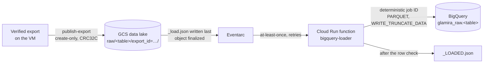

# Raw layer in BigQuery: event-driven, idempotent load

**Result:** the full Parquet export was loaded into BigQuery dataset `glamira_raw`:
- 45,614,951 rows in four tables;
- uploaded in 48 s, and loaded **23 seconds** after the upload finished;
- exactly one load job per table.

The loaded data matches the export in every check: row counts, all 65 daily counts, the nested-field conversion counts, the NUMERIC columns and the cross-table join coverage.

**Observed:** 2026-11-22 (UTC), project region `asia-southeast1`. The earlier Avro load ran on 2026-11-18.
**Code:** [`src/glamira_pipeline/warehouse/`](../../src/glamira_pipeline/warehouse/README.md).
**Reproduce:** the [GCP setup](../runbooks/gcp_setup.md), then the [load runbook](../runbooks/bigquery_load.md).

| | Full load (Parquet) |
| --- | ---: |
| Tables / rows | 4 / 45,614,951 |
| Data uploaded to GCS | 4.69 GB in 83 objects |
| Upload time (`publish-export`, including SHA-256 verification) | 47.7 s |
| Upload end → all tables loaded | 23 s |
| Load jobs | 4: one per table, no retry jobs |
| BigQuery storage | 25.03 GB logical |
| Checks against the export | all equal |

## 1. Problem

The export stage produces verified Parquet files: 41.4 M events plus three enrichment tables. They must become BigQuery tables that analysts can trust, and the path must survive the usual cloud failures:
- an interrupted upload;
- a duplicated or delayed event;
- a load job that is slow or fails.

Re-running any step must never duplicate rows or leave a table half replaced. The proof must be numbers, not exit codes.

## 2. Architecture

**1. Publish.** `publish-export` runs where the files are.
- It first re-verifies the export: the inventory, every part's SHA-256, and every Parquet footer.
- It then uploads the parts listed in the manifest, the BigQuery schema file and the manifest. Every write is create-only: an existing object must match the local CRC32C, or the publish stops.
- Last, it writes `_load.json`, a deterministic load spec. It holds the source URIs and sizes, the BigQuery schema, the partitioning and clustering, the row count and the export's content hash.
- Because `_load.json` comes last, its appearance means the table is complete in the bucket.

**2. Trigger.** Eventarc delivers every *object finalized* event in the bucket to the function, at least once and with retries. The function ignores everything except `_load.json`.

**3. Load.** The function runs these steps in order:
1. Check that every source object exists with its recorded size.
2. Create the table from the contract if needed, or confirm that the existing table's schema and layout match.
3. Submit a `PARQUET` load with list inference under the job ID `load_<dataset>_<table>_<export-id>_<sha12>`.
4. Wait for the job.
5. Check that the table's row count equals the spec.
6. Write `_LOADED.json`.

**4. Classify failures.**
- **Transient** errors are raised so Eventarc redelivers: a job still running after 480 s, a transient job reason, API errors.
- **Permanent** errors are logged once and not retried, because a retry cannot fix them: a bad spec, a layout mismatch, a missing part, a row-count mismatch.

| Guarantee | Mechanism |
| --- | --- |
| No partial table in the bucket triggers a load | `_load.json` is written after every other object of the table |
| No object is overwritten | Create-only writes (`if_generation_match=0`) with a CRC32C comparison |
| A repeated or concurrent event never loads twice | `_LOADED.json` short-circuits. Before it exists, the deterministic job ID returns 409 and the loader waits on that same job |
| A table is never half replaced | `WRITE_TRUNCATE_DATA` replaces the rows atomically and keeps the table's schema, partitioning and clustering |
| The table schema never comes from the files | Tables are created from the contract; lists load as REPEATED through list inference |
| Completeness is proven | The table's `num_rows` must equal the export's row count before the marker is written |
| Least privilege | The loader's account can read the bucket and create objects but not overwrite or delete them. It can write only the two allowed datasets |

## 3. Design decisions

| Decision | Alternatives | Why |
| --- | --- | --- |
| **Event-driven load on `_load.json`** | Manual `bq load`; a scheduled job | A schedule can fire on a half-uploaded export, and a manual load is easy to forget or repeat. A completion marker turns "upload finished" into the trigger itself |
| **A load spec written by the producer** | The function reads the repository or the manifest | The function stays small: Google Cloud clients only, with no pyarrow or other project code. It cannot drift from the contract version that produced the files |
| **Deterministic job ID** | Random job IDs plus deduplication | BigQuery refuses a second job with the same ID, which makes retries and duplicated events safe without any state store |
| **`WRITE_TRUNCATE_DATA`** | `WRITE_APPEND`; `WRITE_TRUNCATE`; `MERGE` | Append duplicates on any repeat. `WRITE_TRUNCATE` would replace the table's schema with the one in the files. `MERGE` scans the target. The export is a full snapshot, so an atomic replace is exact |
| **Retries through Eventarc** | Retry loops inside the function | Redelivery outlives a function timeout. Because of the 409 behaviour, a retry becomes a poll on the same job |
| **Publish on the VM** | Download to a workstation first | The VM is in the bucket's region: no egress cost, and 4.46 GB uploaded in about 14 s |
| **Parquet files** | Avro (used until 2026-11-22); JSONL | Half the bytes and faster loads, with type checks at write time like Avro ([file-format decision](../decisions/raw_file_format.md)) |

## 4. Results

### 4.1 Runs compared

The same tables were loaded three times through the same code path, so the runs can be compared directly:
- **Sample:** 100K events into `glamira_raw_sample`, run first to confirm types, modes and the trigger.
- **Avro:** the full export of 2026-11-17, loaded on 2026-11-18.
- **Parquet:** the current full export. Its load replaced the Avro rows atomically through `WRITE_TRUNCATE_DATA`.

| | Sample (Avro, 11-18) | Full, Avro (11-18) | **Full, Parquet (11-22, current)** |
| --- | ---: | ---: | ---: |
| Tables / rows | 1 / 100,000 | 4 / 45,614,951 | **4 / 45,614,951** |
| Objects / bytes uploaded | 5 / 22.4 MB | 87 / 9.30 GB | **83 / 4.69 GB** |
| `publish-export` wall time | 3.2 s | 70.6 s | **47.7 s** |
| Upload end → all tables loaded | (blocked 11 min on a missing role) | 36 s | **23 s** |
| Load jobs | 1 | 4 | **4** |
| `events` load job time | — | 29.1 s | **14.3 s** |
| BigQuery storage | 0.06 GB | 25.03 GB | **25.03 GB** |
| Publish again | 0 uploaded, 5 skipped | — | — |

**Parquet load jobs**, server time:

| Table | Rows | Input bytes | Job time | Avro job time |
| --- | ---: | ---: | ---: | ---: |
| `events` | 41,432,473 | 4,456,997,957 | **14.3 s** | 29.1 s |
| `ip_locations` | 3,239,627 | 220,623,408 | **9.8 s** | 11.3 s |
| `product_option_values` | 923,294 | 9,543,926 | **5.0 s** | 10.3 s |
| `products` | 19,557 | 1,464,053 | **1.4 s** | 1.9 s |

The table is the same 25.03 GB in BigQuery whatever the input format. Parquet halved the bytes uploaded and the `events` load time, as the [file-format decision](../decisions/raw_file_format.md) predicted on one week of data.

### 4.2 Verification

The queries are in [`sql/checks/`](../../sql/checks/). Each expected value comes from the export manifests or from the earlier MongoDB profiles, not from BigQuery itself. The Avro load gave the same values.

| Check | Expected | Full, Parquet |
| --- | --- | --- |
| Rows per table | Manifest rows | 41,432,473 / 3,239,627 / 19,557 / 923,294 ✓ |
| Rows per `_id` day | Chunk rows in the events manifest | **65 / 65 days equal** ✓ |
| `time_stamp` on another day than `_id` | 166, measured before export | 166 ✓ |
| Layout | `events`: DAY partitions on `time_stamp`, clustered by `collection`; REQUIRED kept | ✓; the non-nullable columns equal the contract in all 4 tables |
| Listing filter (`option_filter` set, `option` empty) | Export conversion count | 12,092,054 ✓ |
| Empty cart option arrays | Export conversion count | 148,509 ✓ |
| Event time range | 2020-04-01 00:00:01 → 2020-06-04 10:21:32 UTC | exact ✓ |
| NUMERIC non-null values | 19,120 `price` (0 to 13,217); 888,623 `value_price` (−44 to 1,630,218) | ✓ |
| Geolocated events (`ip_hash` join) | 98.88%, measured on raw IPs in MongoDB | **98.88%** ✓ |
| Product references without attributes | 1.54%, measured in MongoDB | **1.54%** ✓ |

The two joins show more than completeness. `events.ip_hash` and `ip_locations.ip_hash` were pseudonymized separately, and they still reproduce the coverage measured on the raw IPs. So the HMAC keys and the IP normalization agree across tables.

### 4.3 Fault tolerance seen in the real runs

The idempotency rules were exercised by real events, not only by the unit tests:

| What happened | Effect | Outcome |
| --- | --- | --- |
| With **one** trigger (Parquet run), Eventarc still delivered the `events` spec twice within a second | Two invocations loaded the same table at once | **One** BigQuery job. The second invocation got 409 and waited on the first |
| With two triggers on the bucket (Avro run), every object was delivered twice | Duplicate invocations for every table | One job per table; later deliveries stopped at `already_loaded` |
| About 174 events arrived in 11 s (Avro run), and some were rejected before an instance was ready | Cold-start back-pressure on Cloud Run | Redelivered by Eventarc and processed normally |
| The sample's first deliveries were refused for 11 min while the trigger lacked the invoker role | The load could not start | Once the role was granted, Eventarc's redelivery loaded the table with no manual step |

The first row is the important one. Duplicate delivery is not only a misconfiguration: Eventarc guarantees at-least-once delivery, and here it delivered twice even with a clean setup.

## 5. Cost

| Item | Monthly |
| --- | ---: |
| GCS: the Parquet export, 4.7 GB Standard | about $0.10 |
| GCS: the superseded Avro export, 9.3 GB, until removed | about $0.20 |
| BigQuery storage, 25 GB logical | about $0.50 |
| Load jobs | $0 |
| Function, Eventarc, Pub/Sub, Cloud Build | free tier |
| Verification queries, a few GB scanned | free tier (1 TB/month) |

The VM ran only for the export and the publish.

## 6. Limitations and next steps

- **One run each.** Upload and load times come from a single run each; repeat runs will vary.
- **Free-text PII.** `current_url`, `referrer_url` and `key_search` are loaded as sent, so access to `glamira_raw` stays restricted.
- **Loading an older export.** Re-running the `_load.json` of an older export after a newer one fails the row check instead of reloading the old data. Reloading older data is a deliberate operation: publish it under a new export ID.
- **Operations.**
  - Remove the superseded Avro export: `gs://…/raw/*/export_id=full-2026-11-17-w3/` and its copy on the VM.
  - Grant the invoker role on the service only.
  - Return the VM's storage scope to read-only between publishes.
- **Next:** dbt staging models on `glamira_raw.*`, then the business marts and dashboards.
