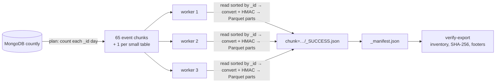

# Full raw export: measured result

**Result:** the four raw tables were exported from MongoDB to Parquet in **42 min 39 s** with 3 worker processes, and verified in **30 s**:
- 45,614,951 rows in 4.69 GB;
- 0 contract violations, no retries;
- byte-deterministic output.

Compared with the first production run (Avro, one process), the export is **3× faster end to end** and the files are **half the size**.

**Observed:** 2026-11-22 on the project VM. Earlier runs were on 2026-11-17.
**How the export works and how to run it:** the [raw layer contract](../raw_layer_contract.md#6-export-run-files-and-checks).
**The design:** the [retry and idempotency decision record](../decisions/export_retry_idempotency.md).
**Why Parquet:** the [format benchmark](../../benchmarks/README.md).

## 1. How a run works

1. **Plan.** `events` is split into one chunk per UTC day of `_id` (65 chunks). Each range is counted, and the counts must add up to the collection count. The other tables are one chunk each.
2. **Export.** Each worker process exports whole chunks:
   - it reads the range sorted by `_id`;
   - it checks every document against the contract and pseudonymizes personal identifiers with HMAC;
   - it writes Snappy Parquet parts in 50,000-row row groups;
   - it commits the chunk with a marker that lists each part's SHA-256.
3. **Complete.** When every chunk is committed, the table's `_manifest.json` is written.
4. **Verify.** `verify-export` checks each table against its manifest without decoding rows:
   - the inventory in both directions;
   - every part's size and SHA-256;
   - every footer's schema and row count against the committed BigQuery schema.

## 2. Environment

| Item | Value |
| --- | --- |
| VM | e2-standard-4: 4 shared vCPU, 16 GB RAM, with MongoDB 8.0 on the same VM |
| Source | `countly.summary` (41,432,473 rows), `ip_locations` (3,239,627), `product_option_values` (923,294), `products` (19,557) |
| Output | The VM data disk, the same disk as the MongoDB data |
| Method | One run per configuration, with the page cache dropped first. Times come from the manifests and from `/usr/bin/time -v` |

## 3. Results: three runs

| | Run 1 | Run 2 | **Run 3 (current)** |
| --- | --- | --- | --- |
| Date, commit | 2026-11-17, `351a36a` | 2026-11-17, `a4ac6e2` | **2026-11-22, `384fae6`** |
| Format | Avro, deflate | Avro, deflate | **Parquet, Snappy** |
| Workers | 1 | 3 | **3** |

| | Run 1 | Run 2 | **Run 3** | Run 3 vs Run 2 |
| --- | ---: | ---: | ---: | ---: |
| Rows written | 45,614,951 | 45,614,951 | **45,614,951** | equal |
| Output | 9.30 GB, 71 parts | 9.30 GB, 71 parts | **4.69 GB, 71 parts** | 0.50× |
| Contract violations / retries | 0 / 0 | 0 / 0 | **0 / 0** | — |
| **Export `events`** | 1 h 41 min | 49 min | **39 min 50 s** | 1.23× faster |
| `ip_locations` | 2 min 15 s | 2 min 16 s | **1 min 47 s** | 1.27× faster |
| `product_option_values` | 1 min 17 s | 1 min 16 s | **56 s** | 1.35× faster |
| `products` | 5 s | 5 s | **4 s** | — |
| Verification | about 21 min (decode every row) | 53 s | **30 s** | 1.8× faster |
| **End to end, including verification** | **2 h 06 min 33 s** | **53 min 39 s** | **43 min 09 s** | 1.24× faster |
| `events` throughput | 6,808 rows/s | 14,054 rows/s | **17,336 rows/s** | ×1.23 |
| CPU used by the export | one core | 262% | **255%** | — |
| Peak memory of the parent process | 112 MB | 102 MB | **357 MB** | Parquet row groups |

Two details about Run 1 and the small tables:
- **Run 1** also decoded every row inside the export. That step is now `verify-export --full`.
- **The three small tables** are one chunk each, so they always run on a single worker.

**Where the `events` time goes.** The figures are summed over chunks, so with 3 workers they are worker-seconds:

| Stage | Run 1 (Avro, 1 worker) | Run 2 (Avro, 3 workers) | **Run 3 (Parquet, 3 workers)** |
| --- | ---: | ---: | ---: |
| Read from MongoDB | 836 s (14%) | 1,075 s (13%) | **1,407 s (20%)** |
| Convert (contract and HMAC) | 2,883 s (47%) | 4,254 s (50%) | **4,297 s (62%)** |
| Write (encode, compress, file) | 2,367 s (39%) | 3,261 s (38%) | **1,172 s (17%)** |
| **Total** | **6,086 s** | **8,590 s** | **6,876 s** |

## 4. Findings

- **Parquet cut the write stage to about a third.** Writing fell from 3,261 to 1,172 worker-seconds, because pyarrow encodes each 50,000-row group in C++. This saved 9 min of wall time on `events`, matching the format benchmark's prediction.
- **Convert is now the bottleneck: 62% of the work.** The contract checks and HMAC run per row in Python. Making the export faster from here means making convert faster, or adding cores. A faster format will not help.
- **Reads took longer with Parquet (1,075 → 1,407 worker-s).** The VM has 4 shared vCPUs. When workers spend less time writing, they request the next batch sooner, so they compete harder with `mongod` for CPU. Reads are still only 20% of the work.
- **Three workers are still 3 workers on 4 shared vCPUs.** The export ran at 255% CPU. Each worker is slower than a lone process would be, so the gain from workers stays below 3×.
- **Memory is the price, and it is affordable.** The parent process peaked at 357 MB against 102 MB with Avro. It exports the small tables itself and buffers one row group of 50,000 rows. Each worker has the same bound, for about 1 GB in total on a 16 GB VM.
- **Verification is faster and stronger.** `verify-export` hashes half as many bytes, so it takes 30 s instead of 53 s. It also checks every Parquet footer's schema and row count, which the Avro check could not do without decoding.
- **The output is the same data.** Every conversion count equals the Avro runs, for example 12,092,054 `option` objects mapped to `option_filter` and 148,509 empty cart option arrays. After the load, BigQuery's per-day counts and joins match too ([load report](bigquery_load.md)).

## 5. Limitations

- **One run per configuration.** Run-to-run variance on shared vCPUs was not measured.
- **Worker counts not swept.** Only 1 and 3 workers were run.
- **Free-text PII.** `current_url`, `referrer_url` and `key_search` are exported as sent.
- **Where the files are.**
  - Run 3's output (`full-2026-11-22`, 4.4 GiB) stays on the VM data disk, and is also published to GCS.
  - Run 2's Avro output (`full-2026-11-17-w3`) also remains on the VM and can be deleted.
  - Run 1's output was deleted on 2026-11-17.
