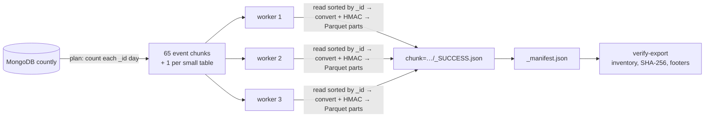

# Full raw export: measured result

**Observed:** 2026-11-22 on the project VM.

**Outcome:** with `--workers 3`, the four raw tables were exported as Parquet in **42 min 39 s** and verified in **30 s**:
- 45,614,951 rows in 4.69 GB;
- 0 contract violations, no retries.

The same export as Avro (2026-11-17) took 52 min 46 s and 9.30 GB.

How the export works and how to run it are in the [raw layer contract](../raw_layer_contract.md#6-export-run-files-and-checks). The design is in the [retry and idempotency decision record](../decisions/export_retry_idempotency.md), and why Parquet replaced Avro is in the [file-format decision record](../decisions/raw_file_format.md).

## 1. How a run works

1. **Plan.** `events` is split into one chunk per UTC day of `_id` (65 chunks). Each range is counted, and the counts must add up to the collection count. The other tables are one chunk each.
2. **Export.** Each worker process exports whole chunks:
   - it reads the range sorted by `_id`;
   - it checks every document against the contract and pseudonymizes PII;
   - it writes Snappy Parquet parts in 50,000-row row groups;
   - it commits the chunk with a marker that lists each part's SHA-256.
3. **Complete.** When every chunk is committed, the table's `_manifest.json` is written.
4. **Verify.** `verify-export` checks each table directory against its manifest, without decoding rows:
   - the inventory in both directions;
   - the size and SHA-256 of each part;
   - each Parquet footer's schema and row count, against the committed `schemas/raw/*.bq.json`.

## 2. Environment

| Item | Value |
| --- | --- |
| VM | e2-standard-4: 4 shared vCPU, 16 GB RAM. MongoDB 8.0 on the same VM |
| Source | `countly.summary` (41,432,473), `ip_locations` (3,239,627), `product_option_values` (923,294), `products` (19,557) |
| Output | VM data disk, the same disk as the MongoDB data |
| Method | One run per format, with the page cache dropped first. Times are from the manifests and from `/usr/bin/time -v` |

## 3. Results: Avro against Parquet

Both runs exported the same data, with the same contract, the same chunk plan and 3 workers.
- **Avro** was commit `a4ac6e2` on 2026-11-17, writing deflate Avro parts.
- **Parquet** is the current exporter: commit `384fae6`, run on 2026-11-22, writing Snappy Parquet parts.

| | Avro (2026-11-17) | **Parquet (2026-11-22)** | Change |
| --- | ---: | ---: | ---: |
| Rows written | 45,614,951 | 45,614,951 | equal |
| Output | 9.30 GB in 71 parts | **4.69 GB in 71 parts** | 0.50× |
| Contract violations / retries | 0 / 0 | 0 / 0 | — |
| **Export `events`** | 49 min (2,948 s) | **39 min 50 s (2,390 s)** | 1.23× faster |
| `ip_locations` | 2 min 16 s | **1 min 47 s** | 1.27× faster |
| `product_option_values` | 1 min 16 s | **56 s** | 1.35× faster |
| `products` | 5 s | **4 s** | — |
| `verify-export` | 53 s | **30 s** | 1.8× faster |
| **End to end, including verification** | **53 min 39 s** | **43 min 09 s** | **1.24× faster** |
| `events` throughput | 14,054 rows/s | **17,336 rows/s** | ×1.23 |
| CPU used by the export | 262% | 255% | — |
| Peak memory of the parent process | 102 MB | 357 MB | row groups in memory |

**Where the `events` time goes.** Times are summed over chunks, so they are worker-seconds, not wall time.

| Stage | Avro | **Parquet** | Change |
| --- | ---: | ---: | ---: |
| Read from MongoDB | 1,075 s (13%) | 1,407 s (20%) | +31% |
| Convert (contract and HMAC) | 4,254 s (50%) | 4,297 s (62%) | equal |
| Write (encode, compress, file) | 3,261 s (38%) | **1,172 s (17%)** | **2.8× faster** |
| **Total** | 8,590 s | **6,876 s** | 0.80× |

The first production run used Avro in a single process and took 2 h 06 min 33 s, because it also decoded every row in the export. Against that run, the current export is 2.9× faster end to end.

## 4. Findings

- **The format change removed most of the write cost.** Writing `events` fell from 3,261 to 1,172 worker-seconds, because pyarrow encodes each 50,000-row group in C++ where fastavro encoded row by row. This alone saved 9 min of wall time.
- **Convert is now the bottleneck, at 62% of the work.** The contract checks and HMAC run per row in Python and cost the same in both runs. Going faster now means optimizing convert or adding cores, not changing the format.
- **Reads took longer (+31%).** Workers that write faster ask MongoDB for the next batch sooner, so they compete harder with `mongod` for the 4 shared vCPUs. Reads are still only 20% of the work.
- **Memory is the price, and it is bounded.** Each process holds one 50,000-row group, about 330 MB. The parent peaked at 357 MB because it exports the small tables itself. Three workers stay near 1 GB on a 16 GB VM.
- **Verification is faster and checks more.** There are half the bytes to hash, so it takes 30 s instead of 53 s. It now also checks every Parquet footer's schema and row count, which Avro could only do by decoding every row.
- **Same data.** Every conversion count equals the Avro run: for example 12,092,054 `option` objects into `option_filter`, and 148,509 empty cart option arrays. BigQuery's per-day counts and joins match after the load ([load report](bigquery_load.md)).

## 5. Limitations

- **One run per format.** Run-to-run variance on shared vCPUs was not measured.
- **Worker counts not swept.** Only 1 and 3 workers were run.
- **Free-text PII.** `current_url`, `referrer_url` and `key_search` are exported as sent.
- **Where the files are.**
  - The Parquet output, `full-2026-11-22` (4.4 GiB), stays on the VM data disk and is published to GCS.
  - The Avro output, `full-2026-11-17-w3`, is superseded and can be deleted from the VM and from GCS.
