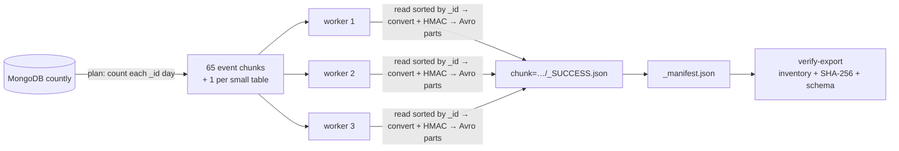

# Full Avro export: measured result

> **Format note.** These runs used the Avro writer, the raw-layer format until 2026-11-22. The export now writes Parquet ([format benchmark](../../benchmarks/README.md)); the chunking, workers, commit protocol and verification measured here are unchanged, and this report will be replaced by the full Parquet run.

**Observed:** 2026-11-17 on the project VM.
**Outcome:** with `--workers 3`, the four raw tables were exported in **52 min 46 s** and verified in **53 s**:
- 45,614,951 rows, 9.30 GB;
- 0 contract violations, no retries.

How the export works and how to run it are in the [raw layer contract](../raw_layer_contract.md#6-export-run-files-and-checks); the design is in the [decision record](../decisions/export_retry_idempotency.md).

## 1. How a run works

1. **Plan.** `events` is split into one chunk per UTC day of `_id` (65 chunks). Each range is counted, and the counts must add up to the collection count. The other tables are one chunk each.
2. **Export.** Each worker process exports whole chunks:
   - it reads the range sorted by `_id`;
   - it checks every document against the contract and pseudonymizes PII;
   - it writes deflate Avro parts and commits the chunk with a marker that lists each part's SHA-256.
3. **Complete.** When every chunk is committed, the table's `_manifest.json` is written.
4. **Verify.** `verify-export` checks each table directory against its manifest: the inventory in both directions, the size and SHA-256 of each part, and the schema against the committed `schemas/raw/*.avsc`. It does not decode rows.

## 2. Environment

| Item | Value |
| --- | --- |
| VM | e2-standard-4: 4 shared vCPU, 16 GB RAM. MongoDB 8.0 on the same VM |
| Source | `countly.summary` (41,432,473), `ip_locations` (3,239,627), `product_option_values` (923,294), `products` (19,557) |
| Output | VM data disk, the same disk as the MongoDB data |
| Method | One run per configuration, each with the page cache dropped first. Times are from the manifests and from `/usr/bin/time -v` |

## 3. Results: one worker against three workers

The two runs exported the same data with the same contract and the same chunk plan.
- **Run 1** used one process, at commit `351a36a`. It also decoded every row again inside the export. That step now runs separately as `verify-export --full`.
- **Run 2** used `--workers 3`, at commit `a4ac6e2`, followed by `verify-export`.

| | Run 1: one worker | Run 2: three workers | Change |
| --- | ---: | ---: | ---: |
| Rows written | 45,614,951 | 45,614,951 | equal |
| Output | 9.30 GB in 71 parts | 9.30 GB in 71 parts | equal |
| Contract violations / retries | 0 / 0 | 0 / 0 | — |
| Plan `events` (count 65 day ranges) | about 30 s | about 17 s | — |
| **Export `events`** | **1 h 41 min** (6,086 s) | **49 min** (2,948 s) | **2.06× faster** |
| Export the 3 small tables | 3 min 37 s | 3 min 37 s | equal (one chunk each) |
| Verification | about 21 min (decode every row) | **53 s** (`verify-export`) | about 24× faster |
| **End to end** | **2 h 06 min 33 s** | **53 min 39 s** | **2.4× faster** |
| `events` throughput | 6,808 rows/s | 14,054 rows/s | ×2.06 |
| Peak memory | 112 MB | 102 MB in the parent; workers not measured | — |

**Where `events` time goes**, summed over chunks. With three workers these are worker-seconds, not wall time.

| Stage | Run 1 | Run 2 | Per-worker slowdown |
| --- | ---: | ---: | ---: |
| Read from MongoDB | 836 s (14%) | 1,075 s (13%) | +29% |
| Convert (contract and HMAC) | 2,883 s (47%) | 4,254 s (50%) | +48% |
| Write (Avro encoding, deflate, file) | 2,367 s (39%) | 3,261 s (38%) | +38% |
| **Total** | **6,086 s** | **8,590 s** | **+41%** |

Run 2's export process used 262% CPU on average. With 4 vCPU, that left roughly one core for `mongod` and the system.

## 4. Findings

- **Three workers gave 2.06×, not 3×.**
  - Each worker processed rows about 30% slower than the single process, because the 4 shared vCPUs also run `mongod`.
  - Two workers could at best reach 2×, and three already reached 2.06×. On this VM, 2 workers therefore cannot beat 3.
- **MongoDB is not the bottleneck.**
  - Reading is 13–14% of the work in both runs, and it slowed down the least.
  - Convert slowed down the most: Python competing with Python for CPU.
- **Convert is the main cost, at about half the work.** More speed needs more cores or less Python work per row, not faster reads.
- **Verification by checksum is cheap.**
  - Hashing 9.30 GB and checking the inventory takes 53 s.
  - Decoding every row took about 21 min, and is only needed to test the Avro library itself.
- **A crash costs little.** The largest `events` chunk (893,200 rows) took about 140 s in a single process. A crash loses at most the chunks that were open.

## 5. Limitations

- **One run per configuration.** Run-to-run variance on shared vCPUs was not measured.
- **Worker counts not swept.** Only 1 and 3 workers were run.
- **`verify-export --full` not timed on the full output.** On the 100K sample it took 1.6 s, against 0.1 s for the default check.
- **PII scan on the sample only.** The scan of decoded rows for raw IPs, emails, device IDs and customer IDs ran on the 100K sample, not on the full output.
- **Not uploaded or loaded.** Run 2's output (export ID `full-2026-11-17-w3`, 8.7 GiB) stays on the VM data disk for the GCS upload and BigQuery load. Only this report is in the repository.
