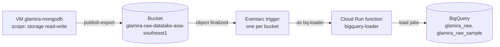

# GCP setup for the raw-layer load

This is a one-time setup. It creates everything the load needs:
- the GCS data-lake bucket;
- the two BigQuery datasets;
- a least-privilege service account;
- the `bigquery-loader` Cloud Function with its trigger;
- storage write access for the VM that holds the export.

Each step gives the **Console** path first, then the equivalent **gcloud** command. Running a load afterwards is covered by the [load runbook](bigquery_load.md).

Console labels change from time to time. If a menu name differs slightly from what is written here, look for the setting itself, such as "Access scopes" or "Retry on failure", rather than the exact wording.

## What gets created



| Resource | Name | Notes |
| --- | --- | --- |
| Bucket | `glamira-raw-datalake-asia-southeast1` | Standard class, uniform access, public access prevented |
| Datasets | `glamira_raw`, `glamira_raw_sample` | Same region as the bucket |
| Service account | `bq-loader` | Runs the function and its trigger |
| Function | `bigquery-loader` (gen2, Python 3.12) | Trigger: object finalized on the bucket, with retries |

All resources live in region **`asia-southeast1`**. A BigQuery load cannot read a bucket in another region.

```bash
export PROJECT=<project-id>
export REGION=asia-southeast1
export BUCKET=glamira-raw-datalake-asia-southeast1
export SA=bq-loader@$PROJECT.iam.gserviceaccount.com
gcloud config set project $PROJECT
```

## 1. Enable the APIs

**Console:** go to *APIs & Services → Library* and enable each of these:
- Cloud Functions
- Cloud Run Admin
- Eventarc
- Cloud Build
- Artifact Registry
- Cloud Pub/Sub

BigQuery and Cloud Storage are usually already on.

```bash
gcloud services enable cloudfunctions.googleapis.com run.googleapis.com eventarc.googleapis.com \
  cloudbuild.googleapis.com artifactregistry.googleapis.com pubsub.googleapis.com
```

## 2. Create the bucket

**Console:** go to *Cloud Storage → Buckets → Create* and set:
- **Name:** `glamira-raw-datalake-asia-southeast1`
- **Location:** Region `asia-southeast1`
- **Storage class:** Standard
- **Access:** Uniform, with *Enforce public access prevention* ticked
- **Protection:** keep the default 7-day soft delete

```bash
gcloud storage buckets create gs://$BUCKET --location $REGION --default-storage-class STANDARD \
  --uniform-bucket-level-access --public-access-prevention
```

## 3. Create the datasets

**Console:** go to *BigQuery → Studio → Explorer*, click ⋮ next to the project, then *Create dataset*:
- **Dataset ID:** `glamira_raw`
- **Location type:** Region `asia-southeast1`
- **Table expiration:** none

Repeat for `glamira_raw_sample`, which holds test loads.

```bash
bq mk --location $REGION --dataset --description "Raw layer, loaded from verified Parquet exports" $PROJECT:glamira_raw
bq mk --location $REGION --dataset --description "Raw layer test loads" $PROJECT:glamira_raw_sample
```

## 4. Create the loader's service account

**Console:** go to *IAM & Admin → Service Accounts → Create service account* and name it `bq-loader`. Grant two project roles:
- **BigQuery Job User**
- **Eventarc Event Receiver**

```bash
gcloud iam service-accounts create bq-loader --display-name "BigQuery raw loader (Cloud Function)"
gcloud projects add-iam-policy-binding $PROJECT --member serviceAccount:$SA --role roles/bigquery.jobUser
gcloud projects add-iam-policy-binding $PROJECT --member serviceAccount:$SA --role roles/eventarc.eventReceiver
```

## 5. Grant access on each resource

Each role is granted on the resource that needs it, never on the whole project.

| Where | Console path | Principal | Role |
| --- | --- | --- | --- |
| `glamira_raw` and `glamira_raw_sample` | *BigQuery → dataset → Sharing → Permissions → Add principal* | `bq-loader` | BigQuery Data Editor |
| The bucket | *Cloud Storage → bucket → Permissions → Grant access* | `bq-loader` | Storage Object Viewer, Storage Object Creator |
| Project | *IAM & Admin → IAM → Grant access* (tick *Include Google-provided role grants*) | `service-<project-number>@gs-project-accounts.iam.gserviceaccount.com`, the Cloud Storage service agent | Pub/Sub Publisher |

**Why these roles:**
- Object Viewer and Object Creator let the loader read specs and write `_LOADED.json`. They do not let it overwrite or delete objects.
- The Cloud Storage service agent must be able to publish bucket events, otherwise no event reaches the function.

```bash
for dataset in glamira_raw glamira_raw_sample; do
  bq add-iam-policy-binding --member serviceAccount:$SA --role roles/bigquery.dataEditor $PROJECT:$dataset
done
for role in roles/storage.objectViewer roles/storage.objectCreator; do
  gcloud storage buckets add-iam-policy-binding gs://$BUCKET --member serviceAccount:$SA --role $role
done
gcloud projects add-iam-policy-binding $PROJECT --role roles/pubsub.publisher \
  --member serviceAccount:$(gcloud storage service-agent --project $PROJECT)
```

## 6. Deploy the function

### Option A: Console

**1. Build the source ZIP** on the workstation:

```bash
scripts/deploy_bigquery_loader.sh --zip ~/bigquery-loader.zip
```

The ZIP holds `main.py`, the pinned `requirements.txt`, and only the warehouse modules the function imports.

**2. Create the function.** Go to *Cloud Run → Write a function*; older consoles show it as *Cloud Run functions → Create function*.

| Setting | Value |
| --- | --- |
| Service name / region | `bigquery-loader` / `asia-southeast1` |
| Runtime | Python 3.12 |
| Authentication | *Require authentication* (not public) |
| Trigger | *Add trigger → Cloud Storage*. Event type `google.cloud.storage.object.v1.finalized`, bucket `glamira-raw-datalake-asia-southeast1`, service account `bq-loader`, **Retry on failure** ticked |
| Service account (runtime / security) | `bq-loader` |
| Memory / CPU | 512 MiB / 1 |
| Request timeout | 540 s |
| Maximum instances | 5 |
| Variable | `ALLOWED_DATASETS` = `glamira_raw,glamira_raw_sample` |
| Source | Upload the ZIP; function entry point `on_object_finalized` |

When the Console offers to grant roles that the trigger is missing, accept.

**3. Create exactly one trigger.** Each trigger delivers every event once more: the load stays correct, but invocations double. After deploying, open *Eventarc → Triggers* and delete any extra trigger that points at `bigquery-loader`.

### Option B: gcloud

```bash
PROJECT=$PROJECT BUCKET=$BUCKET SERVICE_ACCOUNT=$SA ALLOWED_DATASETS=glamira_raw,glamira_raw_sample \
  scripts/deploy_bigquery_loader.sh --dry-run     # review the command and the staged files
PROJECT=$PROJECT BUCKET=$BUCKET SERVICE_ACCOUNT=$SA ALLOWED_DATASETS=glamira_raw,glamira_raw_sample \
  scripts/deploy_bigquery_loader.sh
```

If the deploy reports that Eventarc's service agents are not ready, wait a few minutes and run it again. Eventarc provisions them on first use.

## 7. Let the trigger call the function

The trigger calls the function as `bq-loader`, so that account needs **Cloud Run Invoker** on the function's service. A Console deploy does not always grant it. Without it, every delivery is refused with *"The IAM principal lacks run.routes.invoke"*.

**Console:** go to *Cloud Run → bigquery-loader → Security* (or *Permissions*) → *Add principal*, and give `bq-loader` the **Cloud Run Invoker** role.

```bash
gcloud run services add-iam-policy-binding bigquery-loader --region $REGION \
  --member serviceAccount:$SA --role roles/run.invoker
```

Grant it on the service, not the project: the account then cannot call any other service. Deliveries refused earlier are retried by Eventarc and succeed once the role is in place.

## 8. Give the VM storage write access

`publish-export` runs on the VM that holds the export, using the VM's service account. Its scope must allow writes. You can only change scopes while the VM is stopped.

**Console:** go to *Compute Engine → VM instances → glamira-mongodb* (Stopped) → *Edit* → *Access scopes* → *Set access for each API* → **Storage: Read Write**. Leave the other scopes as they are, then *Save*.

```bash
gcloud compute instances set-service-account glamira-mongodb --zone ${REGION}-b \
  --service-account $(gcloud compute instances describe glamira-mongodb --zone ${REGION}-b \
      --format 'value(serviceAccounts[0].email)') \
  --scopes $(printf 'https://www.googleapis.com/auth/%s,' devstorage.read_write logging.write monitoring.write \
      service.management.readonly servicecontrol trace.append | sed 's/,$//')
```

Pass full scope URLs: gcloud rejects the short form `devstorage.read_write`. When no publish is planned, set Storage back to Read Only.

## 9. Workstation credentials

`publish-export` for the sample and `load-bigquery` run on the workstation with your own account:

```bash
gcloud auth application-default login
```

## 10. Check the setup

```bash
gcloud run services describe bigquery-loader --region $REGION \
  --format 'value(spec.template.spec.serviceAccountName,spec.template.spec.timeoutSeconds)'
gcloud run services get-iam-policy bigquery-loader --region $REGION     # bq-loader has roles/run.invoker
gcloud eventarc triggers list --location $REGION                         # exactly one trigger to bigquery-loader
bq ls                                                                    # glamira_raw, glamira_raw_sample
```

The setup is complete when all of these hold:
- one trigger points to `bigquery-loader`;
- `bq-loader` holds the invoker role on the service;
- both datasets exist in `asia-southeast1`.

Next: the [load runbook](bigquery_load.md).

## Cost

| Item | Monthly estimate |
| --- | --- |
| GCS, 9.3 GB Standard | about $0.20 |
| BigQuery storage, 25 GB logical | about $0.50 |
| Function, Eventarc, Pub/Sub, Cloud Build | free tier at this volume |
| Artifact Registry (function image) | a few cents |
| Load jobs | free |

The VM is the only item that costs real money. It runs only while `publish-export` runs, about 1–2 minutes plus boot time.
