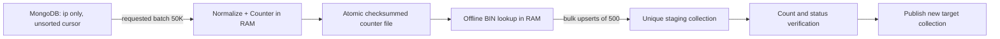

# IP Location — Counter 50K

Read MongoDB events once, normalize only `ip`, and deduplicate frequencies in a Python `Counter`. Resolve unique addresses offline with IP2Location; publish only verified output.



## Run

Install with `uv sync`. Both commands require `MONGODB_URI` pointing to loopback MongoDB (on the VM, or through an SSH tunnel); non-loopback and SRV URIs are refused. For local tests use a genuinely local server, e.g. `MONGODB_URI=mongodb://127.0.0.1:27017/`. MongoDB permissions must allow reading the source and collection metadata, writing staging/provenance, aggregation and collection rename. No API is used.

```bash
# Local: seed a sequential sample, then enrich it.
uv run seed-ip-sample --limit 1000
uv run enrich-ip-locations --database glamira_ip_sample --source events \
  --bin IP-COUNTRY-REGION-CITY.BIN --limit 1000 \
  --output-dir data/ip_location/run_sample

# Full dataset (defaults: --database countly --source summary --target ip_locations).
uv run enrich-ip-locations \
  --bin /path/to/IP-COUNTRY-REGION-CITY.BIN \
  --output-dir /path/to/private/new-run
```

The default target is `ip_locations`. Existing targets are rejected; use `--target ip_locations_new` for another run. The output directory must be new. Keep the source unchanged during a run. `--limit` takes an unsorted, non-random prefix and does not provide representative sampling.

## Output and recovery

`ip_counter.jsonl` contains private normalized IP frequencies and a checksummed manifest with source UUID and BIN identity. It is persisted once after the complete scan, using file/directory synchronization and atomic rename. It is **not a scan checkpoint**: an interrupted scan restarts from zero. Memory grows with unique IP count; cursor reads remain bounded. MongoDB response batches are also capped at 16 MiB, so 50K is a requested maximum, not a measured response size.

BIN lookup uses IP2Location `SHARED_MEMORY` mode and bounded bulk upserts. Each `ip_locations` document contains `_id` (normalized IP), `ip_version`, `status`, `country_code`, `country_name`, `region`, `city`, `database_id`. The default `_id_` index ensures uniqueness; event frequency stays in the counter. `enrichment_runs` stores BIN filename, date, edition, SHA-256 and processing time; `database_id` is the BIN SHA-256. Metadata comes from the actual file.

Missing/null/empty/invalid values are counted separately. Valid IPv4/IPv6 values are normalized; non-public, unsupported IPv6, unmatched and failed lookups retain explicit statuses and null locations. The supplied DB3 BIN is dated 2016-11-29 and lacks IPv6 ranges. Locations are estimates from a database predating the 2019 events; confirm licensing before redistribution.

`ip_location_metrics.json` reports event-weighted and unique-IP coverage, statuses and stage timings. Event coverage divides resolved event frequencies by all events; unique-IP coverage divides resolved IPs by valid unique IPs. The event coverage target is 80%. Files are private; keep counters and generated outputs outside Git. Allow disk space for the counter and staged MongoDB output.

Failures retain staging and artifacts without publishing an incomplete target. Bulk upserts can safely repeat internally, but the CLI does not automatically resume lookup: use a fresh directory/run and target after investigation. Provenance is written before collection publication. Collection rename refuses to replace an existing target. MongoDB publication and the local metrics-file rename are not a cross-system transaction: a late filesystem failure may leave a complete MongoDB target without a final metrics file. No automatic deletion or rollback is attempted.

## Why Counter replaces SQLite

Historical full-data measurements, 4 November 2026:

| Approach | Scan and deduplication | Persistence | Lookup/upsert | Recovery during scan |
| --- | ---: | ---: | ---: | --- |
| SQLite checkpoint | 33m36s, including batch checkpoint writes | Included in scan | 17m49s | Resume saved batches |
| Counter 50K | 7m00s | 17.38s after scan | 6m05s | Restart scan |

Counter matched **41,432,473 events**, **3,239,627 unique valid IPs**, six invalid-format events, and every SQLite per-IP frequency exactly. The measured Counter scan used 649 MiB process high-water RSS; later lookup samples reached 753 MiB. Its private counter artifact was about 160 MB. Resolved coverage was 98.88% of events and 98.82% of unique valid IPs.

These were separate runs with different cache states and stage boundaries, not a controlled A/B test. The timings are directional evidence. Counter removes repeated scan-time SQLite writes and its memory usage fit the tested VM, so we accept restarting a roughly seven-minute scan after failure. Larger datasets or fewer available resources may require revisiting that tradeoff.

## Why keep batch 50K

Two full-scan rounds ran in reverse order: 50K → 100K → 200K, then 200K → 100K → 50K. Each scan produced identical counts and a canonical IP/version/frequency checksum. Geolocation and persistence were excluded.

| Requested batch | Mean total | Read/decode | Normalize/count | Events/s | Highest sampled RSS | Gain vs 50K |
| ---: | ---: | ---: | ---: | ---: | ---: | ---: |
| 50K | 7m05s | 3m07s | 3m58s | 97,489 | 667.6 MiB | baseline |
| 100K | 6m56s | 2m58s | 3m58s | 99,592 | 696.8 MiB | 2.11% |
| 200K | 6m50s | 2m54s | 3m56s | 101,010 | 753.8 MiB | 3.49% |

Both gains were below 5%; retain **50K**. Actual server response counts were not instrumented. RSS was sampled every 100 ms; checksum calculation was excluded from scan time. Only aggregate historical evidence is retained here; obsolete benchmark commands and SQLite implementations were removed.
