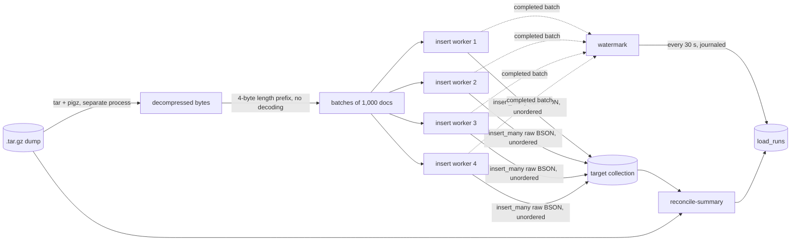

# Full load: operations guide

This package loads `summary.bson` from the original `.tar.gz` mongodump into MongoDB. The load is streamed, parallel and resumable, and it is followed by a read-only reconciliation. The [full-load benchmark report](../../../docs/reports/full_load_benchmark.md) explains *why* it is built this way; this guide explains how to run and verify it.



| Module | Responsibility |
| --- | --- |
| `bson_stream.py` | Open an archive member (`tar`+`pigz`, or `tarfile`), cut documents by length prefix, group them into deterministic batches |
| `writer.py` | Insert one batch as raw BSON; count duplicate-key errors, raise anything else |
| `checkpoint.py` | `load_runs` documents: identity, single-writer lock, resume watermark |
| `metrics.py` | Time and CPU per component (read, split, slot wait, insert, checkpoint) |
| `loader.py` | Orchestration: producer/worker loop, resume, graceful stop, final count check |
| `reconcile.py` | Read-only checks: totals, counts per event type, sampled byte comparison |
| `cli.py` | `load-summary` and `reconcile-summary` |

**Measured on the project VM** (`e2-standard-4`, full 41,432,473 documents, 2026-11-14):

| Run | Wall time |
| --- | ---: |
| Load | 8 min 41 s (about 80K docs/s, peak RSS 106 MB) |
| Resume after a hard kill | 8 min 59 s |
| Reconcile | 11 min 29 s |

The [report](../../../docs/reports/full_load_benchmark.md#6-results-of-the-production-loader) has the breakdown per component.

## Prerequisites

- `uv sync`. `pigz` is optional (`sudo apt install pigz`); without it the loader falls back to Python's `tarfile`, which takes about a third longer to decompress (174 s vs 130 s).
- `MONGODB_URI` in the environment (see `.env.example`). Only loopback hosts are accepted: on the VM use `127.0.0.1:27017`.
- **Permissions:** `insert` and `createCollection` on the target database, plus `find`/`update` on `load_runs` in the same database. `reconcile-summary` also needs `find` on the target.
- **Disk:** no extracted file is written. The target needs about 12 GB for 41.4 M documents.

## 1. Load

```bash
uv run load-summary --archive ~/glamira-source/glamira_ubl_oct2019_nov2019.tar.gz \
  --database countly --collection summary_v2
```

| Option | Default | Meaning |
| --- | --- | --- |
| `--member` | `dump/countly/summary.bson` | BSON file inside the archive |
| `--workers` | 4 | Insert threads (1–16). 4 saturated a 4-vCPU VM; 8 was not faster |
| `--batch-docs` | 1,000 | Documents per `insert_many` (batches are also capped at 16 MB) |
| `--validator` | `warn` | Schema validator for a newly created target (`off` to skip). See below |
| `--no-pigz` | off | Use Python's `tarfile` even if `pigz` is installed |

**What it refuses**
- **Non-empty target:** a target that already holds documents and has no resumable run for this source is rejected.
- **Recreated target:** if the target's UUID changed since the run being resumed, resume is rejected.
- **Concurrent writer:** a target that another run is writing to (heartbeat younger than 120 s) is rejected.

**What it never does:** drop or replace data.

**Validator (`warn`)**
- **Rule:** `_id`, `collection` (string) and `time_stamp` (int/long/double) are required; these are the only fields every event type has.
- **On violation:** the document is still inserted and the violation is written to the `mongod` log, so no source document is lost.

**Exit codes**

| Code | Meaning |
| --- | --- |
| `0` | Loaded and the final count matches the source, or already loaded (a rerun is a no-op) |
| `1` | Configuration, I/O or MongoDB error, or the final count does not match |
| `2` | Another run is writing to the target |
| `130` | Stopped by SIGINT/SIGTERM/SIGHUP after in-flight batches finished and the checkpoint was saved |

## 2. Resume after a stop or crash

Run the **same command** again.

- **Run identity:** a run is identified by the archive SHA-256, the member, the target namespace and the batch limits. The same inputs always produce the same batch boundaries.
- **Skipped batches:** the new run skips every batch below the saved watermark. Those bytes are still decompressed but are not sent to MongoDB.
- **Batches written but not checkpointed:** a crash can leave up to 30 s of batches in the target without a checkpoint. Re-inserting them fails per document with duplicate-key error 11000; the loader counts these as `duplicates` and moves on.
- **Why this is safe:** the source `_id` is the idempotency key. A replay can neither create a second copy nor skip a document.
- **Cost:** skipped batches are still decompressed, and a duplicate costs about 5× an insert. A resume therefore takes about as long as a full load (measured: 8 min 59 s after a kill at 36 %).
- **After a hard kill** (SIGKILL, VM reset): wait about 2 minutes for the old heartbeat to expire. Until then the loader reports the target as busy (exit 2).

## 3. Reconcile

```bash
uv run reconcile-summary --archive ~/glamira-source/glamira_ubl_oct2019_nov2019.tar.gz \
  --database countly --collection summary_v2
```

The command is read-only on the target. It stores a `summary_reconcile` document in `load_runs` and exits with `3` if any check fails.

| Check | How |
| --- | --- |
| Total | Documents streamed from the source = documents in the target |
| Per event type | Source count per `collection` value = one `$group` on the target |
| Content | 1,000 source documents chosen by seeded reservoir sampling are fetched by `_id` and compared byte-for-byte (SHA-256), with decoded equality as a fallback |

## `load_runs` documents

| Field | Content |
| --- | --- |
| `type` | `summary_load` or `summary_reconcile` |
| `status` | `running`, `completed`, `stopped`, `failed` or `abandoned` |
| `identity` | `source_sha256`, `member`, `target`, `batch_docs`, `max_batch_bytes`: what a resume must match |
| `source`, `target` | Archive name, size and SHA-256; target namespace and collection UUID |
| `progress` | `batches_done` (watermark), `offset`, `docs_seen`, `docs_skipped`, `docs_sent`, `inserted`, `duplicates` |
| `metrics` | Seconds per component, process and decompressor CPU, peak RSS, documents per second, throughput per million documents |
| Other fields | `params`, `resumed_from`, `git_sha`, `started_at`, `heartbeat_at`, `finished_at`, `error` |

**How to read `metrics`**

| Field | Meaning |
| --- | --- |
| `source_wait_s` | Time the producer waited for decompressed bytes |
| `split_s` | Time spent cutting documents into batches |
| `slot_wait_s` | Time the producer waited because every insert worker was busy. A large value means MongoDB is the bottleneck |
| `insert_wall_s`, `insert_cpu_s` | Summed over workers. CPU here is client-side only; `mongod` CPU is not included |
