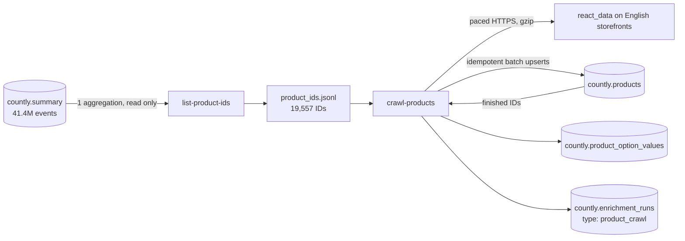

# Product enrichment: operations guide

This package attaches product attributes to the product IDs seen in `countly.summary`. It does this by crawling Glamira's public `react_data` endpoint into MongoDB. The [decision record](../../../docs/decisions/product_crawl.md) explains *why* it is built this way; this guide explains how to run and verify it.



| Module | Responsibility |
| --- | --- |
| `catalog_ids.py` | Aggregation that lists distinct product IDs, and its atomic file output |
| `stores.py` | English storefronts in priority order |
| `http_client.py` | One honest HTTP request and its classification (`ok` / `not_found` / `blocked` / `error`) |
| `react_data.py` | Pure conversion of a payload into `products` and option documents |
| `mongo_store.py` | Collections, validators, checkpoint, batch writes and run lock |
| `crawl.py` | Pacing, concurrency, store fallback, batching and graceful stop |
| `cli.py` | Argument validation, run lifecycle and block backoff |

## Prerequisites

- `uv sync`.
- `MONGODB_URI` in the environment (see `.env.example`). MongoDB stays bound to loopback: on the VM use `127.0.0.1:27017`; from a workstation use an SSH tunnel such as `-L 127.0.0.1:27018:127.0.0.1:27017`. Non-loopback URIs are refused. Never put the URI on the command line or in logs.
- On the VM, run long crawls inside `tmux`. An SSH hangup (`SIGHUP`) is handled like Ctrl+C: in-flight requests finish, the batch is flushed and the run is recorded as `stopped`.
- **Permissions:**
  - `list-product-ids` needs read access to the source.
  - The other two commands need write access to the three target collections and `collMod`/`createIndex` on them.

## 1. List distinct product IDs (read only, full scan)

```bash
uv run list-product-ids --explain --output-dir data/product_ids/full   # plan only, no scan
uv run list-product-ids --output-dir data/product_ids/full
```

- **What it scans:** one `$project → $unwind → $group` over `product_id`, `viewing_product_id` and every `cart_products[].product_id`.
- **Grouping:** values are grouped by their string form, because cart IDs are int32 and event IDs are strings.
- **Exclusions and transfer:** missing, null and empty values are excluded. Only grouped rows cross the network (client RSS about 49 MB).
- **Outputs:**
  - `product_ids.jsonl`: one row per ID with reference counts per field and BSON types.
  - `summary.json`: distinct count, query time and source identity (namespace and collection UUID).
- **Reruns:** files are replaced atomically, so a rerun is safe.
- **Measured:** 19,557 IDs from 41,432,473 documents in 375 s ([report](../../../docs/reports/product_ids_distinct.md)).

## 2. Create the collections (once, idempotent)

```bash
uv run setup-product-collections
```

- **Creates:** `products` and `product_option_values`, each with a strict `$jsonSchema` validator, plus indexes on `products.status` and `product_option_values.product_id`. On later runs it only re-applies the validator.
- **Never touches:** source collections are not modified, and nothing is dropped.
- **Guard:** `crawl-products` refuses to start when either validator is missing or out of date.

## 3. Crawl

```bash
uv run crawl-products --ids-file data/product_ids/full/product_ids.jsonl \
  --delay 0.2 --jitter 0.1 --concurrency 6 --block-retries 3
```

| Option | Default | Meaning |
| --- | --- | --- |
| `--delay` | 3.0 | Minimum seconds between request *starts*; at least 0.125 (8 req/s hard cap) |
| `--jitter` | 0 | Extra uniform random seconds added to each gap |
| `--concurrency` | 1 | Products in flight (1–8). Throughput ≈ `min(1/delay, concurrency/latency)` |
| `--max-stores` | 3 | Stores tried, in priority order, while the response is 404 |
| `--batch-size` | 200 | Products per MongoDB write; batches also flush every 30 s |
| `--max-attempts` | 3 | `error` attempts before an ID is left alone |
| `--limit` | all | First N input IDs, taken *before* finished IDs are removed |
| `--recheck-not-found` | off | Treat `not_found` as unfinished (combine with `--max-stores 11`) |
| `--block-retries` / `--block-wait` | 0 / 300 s | Resume after a block, waiting 300 → 600 → 1200 s (at most 3 times) |
| `--raw-dir` | off | Also save each raw payload as gzip, for debugging |

**Resuming.** Run the same command again. Nothing needs to be cleaned up first.

**Exit codes**

| Code | Meaning |
| --- | --- |
| `0` | Every pending ID was processed |
| `1` | Input, configuration or MongoDB failure |
| `2` | Another crawl holds the lock |
| `3` | Stopped after a block, or after 3 consecutive network errors |
| `130` | Interrupted |

### Status and attempts

| Status | When | Finished? | Counts as an attempt? |
| --- | --- | --- | --- |
| `success` | 200 JSON with `product_id` | Yes | Yes |
| `not_found` | 404 JSON on every store tried | Yes (unless `--recheck-not-found`) | Yes |
| `error` | Network failure, 5xx, unparseable payload | After `--max-attempts` | Yes |
| `blocked` | 401/403/429 or a non-JSON 200 (challenge page) | No | **No**: a block says nothing about the product |

## How correctness and safe retries are ensured

**Correctness**
- **Validated writes:** both collections reject any document that does not match the schema (`validationLevel: strict`, `validationAction: error`).
- **One shape for every outcome:** the document builder in `react_data.py` is a pure function. It always emits the same key set, with data fields set to null unless the status is `success`. A `not_found` row is therefore explicit, not missing.
- **Exact prices:** prices are parsed into `Decimal128`. A non-numeric or boolean price turns that product into `error` with a message instead of storing a wrong value.
- **Source values kept:** `gender: false` stays `false`, and IDs are normalized to strings so they join with events.
- **Traceable runs:** each run stores its parameters, input file SHA-256, git SHA, metrics and stop reason in `enrichment_runs`.

**Retry and recovery**
- **The data is the checkpoint.** At start, the crawler loads `_id`, `status` and `attempts` from `products` and crawls `input − finished`. Input order is irrelevant.
- **Idempotent batches:**
  - Products are written with `UpdateOne(..., {"$set": doc}, upsert=True)`.
  - Option rows are written with `ReplaceOne(..., upsert=True)` on a compound `_id`.
  - `attempts` is computed by the crawler and *set* rather than incremented, so a batch replayed after a partial failure leaves identical documents.
  - Option rows from older runs of a successfully recrawled product are deleted *after* the new rows are written.
- **Bounded loss:** a batch is flushed on size, on time, and always in `finally`. A hard kill loses at most the unflushed buffer, and those IDs are simply crawled again.
- **Graceful stop:**
  - The first SIGINT/SIGTERM stops new requests, lets in-flight ones finish, flushes, and records the run as `stopped`.
  - A repeat within 2 s is ignored, because `uv run` forwards one Ctrl+C twice. A later repeat aborts.
- **Single writer:** a run refuses to start while another `product_crawl` run has a heartbeat younger than 120 s. A stale `running` run is marked `abandoned`.
- **Blocks:** the crawler stops at once, flushes, and optionally resumes after a doubling wait. It never retries in a tight loop and never bypasses a challenge.

## Collections

### `products` (one document per input product ID)

| Field | Type | Notes |
| --- | --- | --- |
| `_id`, `product_id` | string | Same form as the event `product_id` |
| `status`, `status_code` | enum, int \| null | `status_code` is null on network errors |
| `attempts`, `error` | int, string \| null | |
| `name`, `sku`, `product_type`, `product_type_value`, `attribute_set`, `type_id`, `collection`, `collection_id`, `category_name`, `currency`, `*_format` | string \| null | As served |
| `attribute_set_id`, `category` | int \| string \| null | `category` is usually `0` |
| `gender` | string \| `false` \| null | `false` kept as served (mostly wedding rings) |
| `price`, `min_price`, `max_price`, `full_price`, `sale_price` | Decimal128 \| null | Store currency, tax included |
| `include_tax`, `use_gold_price`, `default_tax`, `current_tax`, `option_count` | bool / number \| null | |
| `source` | `{host, store_code, url, requested_currency}` | The store that produced the final answer |
| `run_id`, `crawled_at` | string, date (UTC) | |

### `product_option_values` (reference only)

- **Key:** `_id = {product_id, option_id, value_id}`, one row per option value. All IDs are strings; cart events store them as ints.
- **What a row maps:** an event `value_id` to its URL token (`value_sku`) and labels (`value_title`, `value_default_title`, `value_store_title`).
- **Other fields:** `part_type`, `option_type`, `is_default`, `value_price` (Decimal128) and `price_type`.
- **Free-text options** such as engraving have `value_id = null`.

### `enrichment_runs` (shared with IP enrichment)

| Field | Content |
| --- | --- |
| `type` | `"product_crawl"`. IP enrichment provenance documents have no `type` |
| `status` | `running`, `completed`, `stopped`, `failed` or `abandoned` |
| `params` | Includes `block_retry` |
| Other fields | `input {file, sha256, ids}`, `git_sha`, `started_at`, `heartbeat_at`, `finished_at`, `progress`, `metrics`, `stop_reason` |

## Verifying a run

```javascript
db.products.countDocuments({})                                 // = number of input IDs
db.products.aggregate([{$group: {_id: {s: "$status", a: "$attempts"}, n: {$sum: 1}}}])
db.products.aggregate([{$group: {_id: null, n: {$sum: "$option_count"}}}])   // = distinct (product_id, option_id) pairs
db.product_option_values.aggregate([{$group: {_id: {p: "$product_id", o: "$option_id"}}}, {$count: "pairs"}])
db.products.aggregate([{$match: {status: "success"}}, {$group: {_id: {$type: "$price"}, n: {$sum: 1}}}])
db.enrichment_runs.find({type: "product_crawl"}).sort({started_at: -1}).limit(3)
```

**Last verified 2026-11-13**

| Check | Result |
| --- | --- |
| Products | 19,557 documents, matching the input exactly |
| Status | 19,121 `success` and 436 `not_found`; no `error` or `blocked` remains |
| Option rows | 923,294 rows. The 170,256 product–option pairs equal the sum of `option_count` |
| Price type | All decimal except one `deposit` product with a null `price` |
| Re-check of `not_found` | 436 × 11 stores, all 404 |

## Limitations

- The catalog and prices are from 2026, not from the 2019 events. Revenue analysis must use event prices.
- 436 IDs (1.54% of event product references) no longer exist on any English store.
- One requesting IP; the safe rate depends on Akamai's current policy (see the decision record).
- `gender` mixes string and boolean. The raw export writes it as STRING, with `false` → `"false"`; see the [raw layer contract](../../../docs/raw_layer_contract.md#53-rawproducts).
