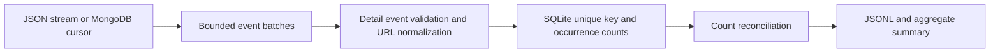

# Product configuration deduplication

This step prepares observed product configurations for a later crawler. It does not fetch websites or infer website defaults. Both local JSON and MongoDB use the same normalization and SQLite counting functions.

The same scan also extracts `current_url` from **all event types** into a disk-backed inventory. `product_urls.jsonl` contains every observed URL variant whose exact hostname/path has product evidence elsewhere in the source. Evidence comes from `.html` paths (including a trailing slash) and observed Magento `/catalog/product/view/id/…` routes when an event carries `product_id` or `viewing_product_id` and a store ID. There is no event type allowlist, so a new event type can contribute without a code change. Product/store mappings are arrays and retain which ID field supplied each association. No hostname is rewritten or country inferred.

`unverified_product_urls.jsonl` retains product-shaped URLs without ID evidence for review: the suffix or route alone is not proof of a product page. Checkout, listing, account and home paths do not establish product evidence. Exact URL variants (including query/tracking) remain separate in this inventory; occurrences count `current_url` fields only. Configuration counts still refer only to detail events. Referrer URLs are never projected or read. This is evidence from the supplied source, not a guarantee of discovering every website product. Version 3 checkpoints require a fresh output directory rather than resuming older extraction checkpoints. Use `data/product_configurations/current_url_only_100k` for the latest local validation.

The subsequent [MongoDB event research](../../../analysis/product_configuration_research/README.md) covers all 27 event types and documents unresolved selection, quality, recommendation and cart semantics. Its handling proposals await review; this workflow still implements the earlier local checkpoint described below.

## Commands

```bash
uv sync
uv run deduplicate-products --sample data/summary_sample.json \
  --limit 100000 --batch-size 5000 \
  --output-dir data/product_configurations/sample_100k_final
```

`--limit` counts **all source documents before event filtering** and requires that many rows to exist. Only `collection == "view_product_detail"` contributes configurations. Omitting the limit processes the complete input. JSON input is a streamed MongoDB Extended JSON array, not a JSONL file. A sample prefix is sequential and non-random.

The prepared VM command, to run from the deployed repository after VM access is available, is:

```bash
# Load MONGODB_URI from the existing protected VM configuration into the environment.
# Do not put credentials in the command or print the configuration.
uv sync --frozen
uv run deduplicate-products --mongo --database countly --collection summary \
  --batch-size 5000 --output-dir /data/glamira_products/configurations_full_v1
```

Review the [research decisions](../../../analysis/product_configuration_research/OPEN_QUESTIONS.md) before authorizing a full extraction. Use a read-only MongoDB account with source read and collection-metadata permissions. Connection settings come from `MONGODB_URI`; the library contains no GCP or SSH settings. Reserve disk for SQLite plus JSONL export on the data disk. This command scans source events once, projecting only `_id`, `collection`, `product_id`, `store_id`, `current_url`, `option`, and `viewing_product_id`. The MongoDB source must have ObjectId identifiers and remain unchanged through completion/resume. `_id` sorting uses the existing default index; it avoids an unindexed event-type query or a new index.

## Identity and normalization

Sample inspection found `store_id`, not `store`. Several store IDs share one hostname, so the unique key is **(product_id, store_id, hostname, normalized_options)**. Output `store` is an alias of the original `store_id`; hostname is stored separately in full, for example `www.glamira.co.uk`. Product and store IDs must be nonempty strings; neither is inferred from the URL.

- HTML entities such as `&amp;` are decoded before URL parsing. Only absolute HTTP(S) URLs without credentials or unusual ports are accepted.
- Query options are percent-decoded once, sorted by key, and serialized deterministically. Case and decoded value text are preserved; standard query decoding interprets `+` as a space. No translation or semantic mapping occurs.
- Missing options and values equal to the empty string are omitted. A URL without remaining options yields `{}`. No default configuration is added for products that were observed only with options.
- Repeated identical nonempty values collapse to one pair; distinct values for the same key reject the event. Invalid encoding, malformed query keys, and missing/invalid identifiers are counted explicitly. The first fatal reason is counted per rejected event.
- Advertising parameters `gclid`, `fbclid`, `dclid`, `msclkid`, `gbraid`, `wbraid`, `ttclid`, `keyword`, `matchtype`, `campaignid`, and prefixes `utm_`/`itm_` are excluded. The technical `no_cache` parameter is also excluded. Matching these exclusion names ignores case.
- Unknown parameters are retained and flagged, including ambiguous keys such as `smartid`, `discountid` and `___store`. This can conservatively split configurations; the policy should be reviewed before crawling. Unknown values are never silently discarded.

The observed `option` arrays contain `alloy`/`diamond` internal IDs and blank value labels. The implementation compares URL key presence with available option labels and counts validation warnings. It cannot verify ID-to-URL-value equality without a mapping. Populated internal IDs never supply missing URL options. Historical claims of exact option/URL value parity are therefore unverified for this sample.

`source_url` is the first accepted representative URL in source order, HTML-decoded but otherwise retained, including tracking parameters. Tracking values do not enter the key. Some events point at checkout configuration pages or development hosts: retaining an observed URL does not assert that it is a public, crawlable product page. A future crawler must validate its target policy separately.

## Storage, resume and outputs



SQLite holds the unique set on disk with an 8 MiB page cache; memory holds only the current event batch. MongoDB requested batches are additionally constrained by its 16 MiB response limit. Batch size defaults to 5,000 and does not change normalization.

Each SQLite transaction commits occurrence increments, aggregate counters and source progress together. On interruption, rerun the identical command and output directory. JSON resume reparses and skips the committed prefix; MongoDB resumes at `_id > last_committed_id`. These assume an immutable source; collection UUID detects collection recreation, not in-place edits. JSON identity includes its SHA-256. Source, limit and normalization version changes reject checkpoint reuse. Use only one process per output directory. A hard power failure can lose timing for the interrupted invocation, but committed event counts remain recoverable.

Outputs are `configurations.sqlite3`, `configurations.jsonl`, `summary.json`, and `summary.md`. SQLite and JSONL have mode `0600`; keep the output directory private. Use ignored `data/` locally and private paths outside version control on the VM. JSONL is exported only after the scan completes and count equations reconcile, with temporary-file rename protecting publication. SQLite and filesystem outputs are not one atomic transaction; rerunning a completed checkpoint regenerates exports without increasing counts. Summary files are regenerable and are not a completion marker.

Each JSONL row has `product_id`, `store`, `store_id`, `hostname`, `normalized_options`, `source_url`, and `occurrence_count`. There are no fabricated default rows. Output examples and measured local results are in the [checkpoint report](../../../docs/reports/product_configuration_deduplication.md).

## Validation

```bash
uv run python -m unittest discover -s tests/unit -v
uv run deduplicate-products --help
git diff --check
```

Tests cover ordering, tracking, HTML escaping, empty values, unknown values, distinct stores/products/hosts, malformed URLs, conflicting repeated options, transaction rollback, interruption/resume, changed input rejection, exact limits and MongoDB cursor projection/order. MongoDB cursor tests use mocks; the executed 100K benchmark uses the real local JSON sample. Full-dataset runtime and MongoDB integration performance remain unmeasured.

## Distinct product IDs (MongoDB, read only)

```bash
# MONGODB_URI points at the SSH-tunnelled loopback server with a read-only user.
uv run list-product-ids --explain --output-dir data/product_ids/full   # query plan only
uv run list-product-ids --output-dir data/product_ids/full
```

One aggregation scans `countly.summary` once and groups `product_id`, `viewing_product_id` and `cart_products[].product_id` by their string form. Only grouped rows cross the network. Outputs are `product_ids.jsonl` (one row per ID with reference counts per field and BSON types) and `summary.json` (distinct count, query seconds, source identity). There are no source writes or new indexes. Rerunning replaces outputs atomically.

## react_data crawl into MongoDB

```bash
# MONGODB_URI points at the SSH-tunnelled server with write access to the new collections.
uv run setup-product-collections                 # once; idempotent
uv run crawl-products --ids-file data/product_ids/full/product_ids.jsonl \
  --delay 0.125 --concurrency 8 [--jitter 0.1] [--limit 50] [--raw-dir data/product_crawl/raw]
```

- **Collections:** `setup-product-collections` creates (or re-applies) `countly.products` and `countly.product_option_values`, each with a strict `$jsonSchema` validator, plus indexes `products.status` and `product_option_values.product_id`. Source collections are never modified and nothing is dropped. `crawl-products` refuses to start if the validators are missing or outdated.
- **Checkpoint = data:** a product is finished when its `products` document has `status` `success` or `not_found`, or `error` after `--max-attempts` (3) attempts. Each run crawls `input IDs − finished IDs`; input order is irrelevant. `--limit N` takes the first N input IDs *before* skipping finished ones, so reruns of one command converge to the same set.
- **Idempotency:** writes are upserts on fixed `_id`s, in batches of `--batch-size` (200) or every 30 s. `attempts` is computed from the previous document and *set* (not incremented), so replaying a batch after a partial failure gives identical documents. A crash loses at most the unflushed batch, which the next run recrawls.
- **Stores:** stores are tried in `stores.py` order (English storefronts, USD → EUR → GBP → …). The next store is tried only on 404, up to `--max-stores` (3).
- **Stopping:**
  - 401/403/429 or a non-JSON page records `blocked` (not counted as an attempt), flushes and stops with exit 3; 3 consecutive network errors also stop the run.
  - `--block-retries N` (0–3, default 0) waits and resumes after a block. The waits are `--block-wait` seconds (minimum 300), then double each time (300 → 600 → 1200 s). Each resume is a new run document; a block after the last retry ends the command with exit 3. Clients stay plain and honest: challenges are never solved or bypassed.
  - Ctrl+C/SIGTERM stops gracefully: in-flight requests finish and the batch is flushed. A second signal more than 2 s later aborts.
- **Pacing:** request starts are spaced by `--delay` (minimum 0.125 s, so at most 8 req/s) plus up to `--jitter` random seconds. `--concurrency` (1–8) sets how many products are in flight.
- **Runs:** each run is a document in the existing `countly.enrichment_runs` with `type: "product_crawl"`, `_id = run_id`, `status` (`running`/`completed`/`stopped`/`failed`/`abandoned`), params, input file name and SHA-256, git SHA, heartbeat, progress and metrics. A second crawl is refused while a run has a heartbeat younger than 120 s; older `running` runs are marked `abandoned`.
- **Raw JSON** is saved (gzip) to files only with `--raw-dir`.

### `products` (one document per product ID)

| Field | Type | Notes |
| --- | --- | --- |
| `_id`, `product_id` | string | Same form as event `product_id` |
| `status` | `success` \| `not_found` \| `error` \| `blocked` | |
| `status_code` | int \| null | HTTP status; null on network errors |
| `attempts`, `error` | int, string \| null | |
| `name`, `sku`, `product_type`, `product_type_value`, `attribute_set`, `type_id`, `collection`, `collection_id`, `category_name`, `currency`, `*_format` | string \| null | As served |
| `attribute_set_id`, `category` | int \| string \| null | `category` is usually `0`; mixed types observed |
| `gender` | string \| `false` \| null | `false` is kept as served (mostly wedding rings) |
| `price`, `min_price`, `max_price`, `full_price`, `sale_price` | Decimal128 \| null | Store currency, tax included |
| `include_tax`, `use_gold_price`, `default_tax`, `current_tax`, `option_count` | bool / number | |
| `source` | `{host, store_code, url, requested_currency}` | Store that served the data |
| `run_id`, `crawled_at` | string, date (UTC) | |

Data fields are null unless `status == "success"`. For BigQuery, Decimal128 maps to `NUMERIC`. `gender` mixes string and boolean, so its representation must be chosen at export or staging time.

### `product_option_values` (reference only)

`_id = {product_id, option_id, value_id}`. One row per option value, mapping the event `value_id` to the URL token (`value_sku`) and labels (`value_title`, `value_default_title`, `value_store_title`), with `part_type`, `option_type`, `is_default`, `value_price` (Decimal128) and `price_type`. Options without values (free-text engraving) have `value_id = null`. IDs are strings; cart events store them as ints. Rows of a product that disappear from the site are removed when that product is recrawled successfully.
