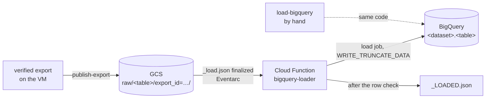

# Warehouse load: operations guide

This package moves a verified raw export into BigQuery in two steps:
1. `publish-export` uploads the export to GCS.
2. A Cloud Function, `bigquery-loader`, sees the upload complete and loads each table.

Both steps are safe to repeat: a retry never duplicates rows or overwrites objects. The step-by-step first run is in the [runbook](../../../docs/runbooks/bigquery_load.md), and the design is §7 of the [export decision record](../../../docs/decisions/export_retry_idempotency.md).



## Objects in GCS

```text
gs://<bucket>/<prefix>/<table>/export_id=<export-id>/
  chunk=<id>/part-NNNNN.avro      the parts listed in the export manifest
  <table>.avsc, <table>.bq.json   schemas the parts were written with
  _manifest.json                  the export manifest
  _load.json                      written last: the load spec and the trigger
  _LOADED.json                    written by the loader after a verified load
```

`_load.json` holds everything the load needs, so the function never reads the repository:
- the export ID, the target dataset and table, and the row count;
- `content_sha256`;
- every part's URI and size;
- the BigQuery schema, partitioning and clustering, taken from the [table contract](../export/tables.py).

## Commands

```bash
# Where the export is (the VM for the full export). Needs storage write access.
uv run publish-export <export dir or table dir> --bucket <bucket> [--prefix raw] [--dataset raw] [--workers 4]

# By hand, with Application Default Credentials. Normally the function does this.
uv run load-bigquery gs://<bucket>/raw/<table>/export_id=<id>/_load.json [--ignore-marker]
```

| Command | Exit 0 | Exit 1 |
| --- | --- | --- |
| `publish-export` | Every table is in GCS, uploaded now or already there with the same CRC32C. Prints the `_load.json` URIs | Verification failed, the BigQuery schema differs from the contract, an object exists with other content, or a GCS error |
| `load-bigquery` | `loaded`, or `already_loaded` when `_LOADED.json` exists | Missing or resized part, table layout differs, job failed, row count differs, or the job is still running (rerun later) |

The Google Cloud libraries print a `FutureWarning` on Python 3.10. Publishing and loading still work, and the Cloud Function runs on Python 3.12.

## Why a repeat is harmless

| Step | Guarantee | Mechanism |
| --- | --- | --- |
| Upload | Never overwrites; a rerun uploads only what is missing | Create-only writes (`if_generation_match=0`). An existing object must match the local CRC32C. GCS checks each upload's CRC32C |
| Trigger | Fires once the table is complete in the bucket | `_load.json` is written after every part, the schemas and the manifest |
| Repeated event | No second load | `_LOADED.json` short-circuits. Without it, the deterministic job ID `load_<dataset>_<table>_<export-id>_<sha12>` returns 409, and the loader waits for that same job |
| Load | All rows or none; never appends | `WRITE_TRUNCATE_DATA`, an atomic replace that keeps the table schema, partitioning and clustering |
| Result | Counted, not assumed | The table's `num_rows` must equal the spec before `_LOADED.json` is written |

## Failure handling in the function

| Failure | Function | What to do |
| --- | --- | --- |
| Job still running after 480 s, a transient job error, a GCS or BigQuery API error | Raises, so Eventarc redelivers with backoff for up to 24 h. The redelivery waits on the same job | Nothing |
| Malformed spec, dataset not in `ALLOWED_DATASETS`, missing or resized part, table layout differs, job failed permanently, row count differs | Logs `ERROR` with the reason and does not retry | Fix the cause, then run `load-bigquery` on the same `_load.json` |
| An object that is not `_load.json` | Returns at once | — |

Logs are JSON lines with `severity`. Read them with `gcloud functions logs read bigquery-loader --region <region>`.

## Deploying the function

Run [`scripts/deploy_bigquery_loader.sh`](../../../scripts/deploy_bigquery_loader.sh) with `PROJECT`, `BUCKET` and `SERVICE_ACCOUNT` set; `--dry-run` prints the command. The script stages only the modules the function imports:
- `spec.py`, `bigquery.py`, `runner.py`, `function.py`;
- [`functions/bigquery_loader/main.py`](../../../functions/bigquery_loader/main.py) and its pinned `requirements.txt`.

A unit test keeps those modules free of the export package.

**Least privilege for the loader's own service account**

| Role | Scope | Why |
| --- | --- | --- |
| `roles/bigquery.jobUser` | Project | Run load jobs |
| `roles/bigquery.dataEditor` | Each allowed dataset | Create tables, replace their data |
| `roles/storage.objectViewer` | Export bucket | Read specs, list parts |
| `roles/storage.objectCreator` | Export bucket | Write `_LOADED.json`; no overwrite or delete |
| `roles/eventarc.eventReceiver`, `roles/run.invoker` | Project, function | Receive the trigger |

The Cloud Storage service agent also needs `roles/pubsub.publisher` so that bucket events reach Eventarc.

## Modules

| Module | Responsibility |
| --- | --- |
| [`spec.py`](spec.py) | `LoadSpec` (`_load.json`): validation and deterministic job ID |
| [`publish.py`](publish.py) | Verify, upload create-only, write the spec last |
| [`bigquery.py`](bigquery.py) | Source check, table creation and layout check, idempotent job, row check |
| [`runner.py`](runner.py) | Process one spec URI: marker, allowlist, load, `_LOADED.json` |
| [`function.py`](function.py) | Event entry point, error classification, JSON logs |
| [`cli.py`](cli.py) | `publish-export`, `load-bigquery` |
